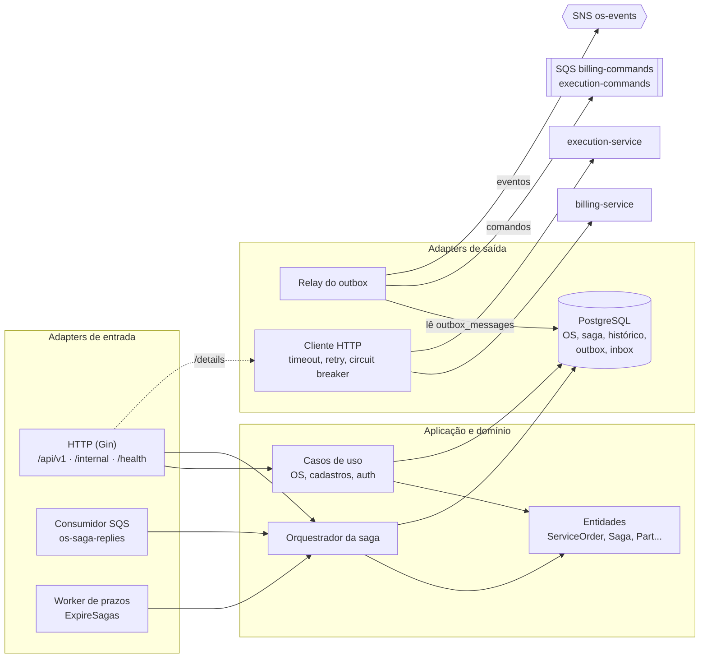
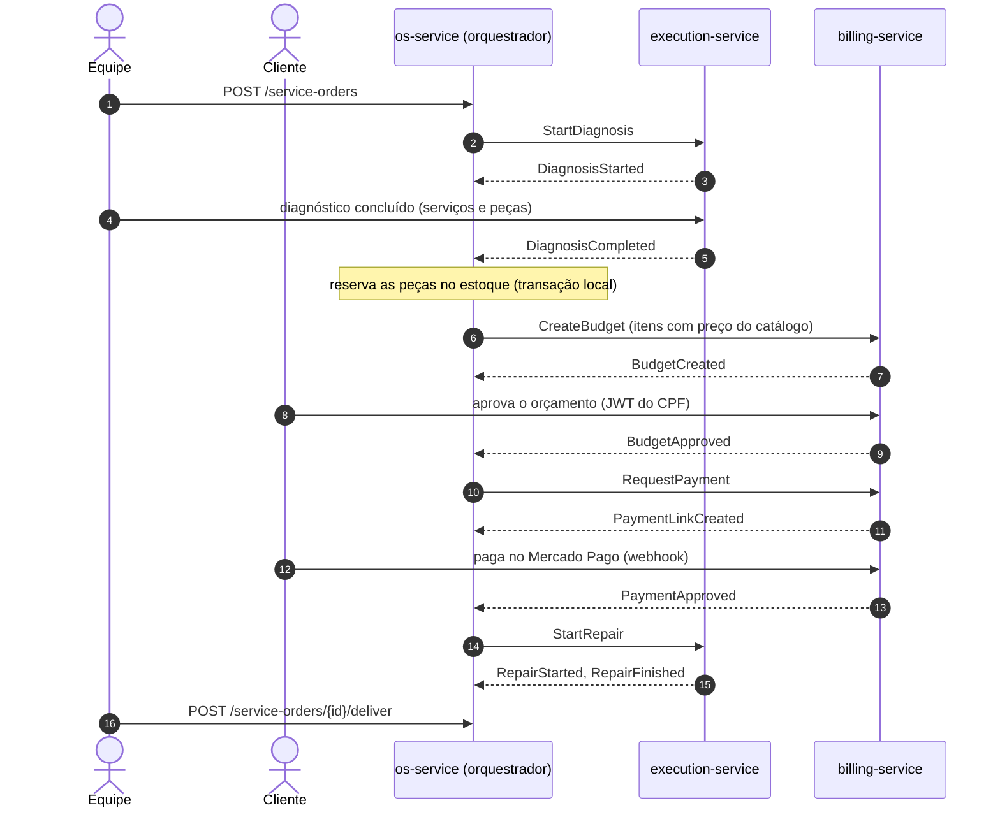

# postech-tc4-os-service

Microsserviço de **Ordem de Serviço** da oficina mecânica e **orquestrador da saga** que coordena orçamento, pagamento e execução entre os serviços.

Tech Challenge Fase 4, FIAP Pós Tech SOAT. A aplicação monolítica da fase 3 foi dividida em microsserviços com o padrão Strangler Fig. Este repositório nasceu do monolito, com o histórico preservado, e ficou com o núcleo da OS; orçamento, pagamento e execução saíram para serviços próprios ([RFC-0004](docs/rfc/0004-decomposicao-em-microsservicos.md)).

| Repositório | Papel | Banco |
|---|---|---|
| **postech-tc4-os-service** (este) | OS, clientes, veículos, catálogo de serviços e peças, estoque; orquestrador da saga | PostgreSQL (RDS) |
| [postech-tc4-billing-service](https://github.com/Kc1t/postech-tc4-billing-service) | orçamento e pagamento com Mercado Pago | PostgreSQL (RDS) |
| [postech-tc4-execution-service](https://github.com/Kc1t/postech-tc4-execution-service) | fila de diagnóstico e reparo da oficina | DynamoDB |
| [postech-tc4-notification-lambda](https://github.com/Kc1t/postech-tc4-notification-lambda) | e-mail ao cliente a cada mudança de status | DynamoDB (deduplicação) |
| [postech-tc4-lambda-auth](https://github.com/Kc1t/postech-tc4-lambda-auth) | CPF → JWT e authorizer do API Gateway | (consulta este serviço) |
| [postech-tc4-infra-k8s](https://github.com/Kc1t/postech-tc4-infra-k8s) | EKS, API Gateway, SNS/SQS/DLQ, observabilidade, e2e local | — |

## Guia rápido para avaliação

| Requisito da fase 4 | Onde está |
|---|---|
| Microsserviço com repositório, infraestrutura e banco próprios | este repo: `infra/` (RDS em Terraform), `k8s/`, `Dockerfile` |
| Saga com compensação, escolha justificada | [Saga orquestrada](#saga-orquestrada) abaixo e [ADR-0017](docs/adr/0017-saga-orquestrada-no-os-service.md) |
| Mensageria e REST | [Mensagens](#mensagens), [AsyncAPI](docs/asyncapi/asyncapi.yaml), [API REST](#api-rest) |
| Nenhum acesso ao banco de outro serviço | a API composition usa REST; a Lambda auth consulta `GET /internal/requesters` em vez de abrir o banco |
| Testes unitários, BDD e cobertura ≥ 80% | [Testes e qualidade](#testes-e-qualidade); BDD em [`features/saga.feature`](features/saga.feature) |
| SonarQube no CI | job `sonarqube` do [CI](.github/workflows/ci.yml), quality gate próprio |
| CI/CD com deploy em Kubernetes | [CI/CD](#cicd) |
| Swagger e Postman | [`docs/swagger.yaml`](docs/swagger.yaml) e [`postman_collection.json`](postman_collection.json) |
| Observabilidade da fase 3 | [Observabilidade](#observabilidade) |
| Decisões de arquitetura | [ADRs](docs/adr/) e [RFCs](docs/rfc/) |

## Responsabilidades

- Abrir a OS, guardar o status e o histórico de cada transição, e consultar a OS pelo id, pelo código ou pelo CPF do cliente.
- Manter clientes, veículos, catálogo de serviços e peças e o estoque. O estoque é reservado e devolvido pela saga.
- Orquestrar a saga da OS: mandar comandos ao execution e ao billing, reagir às respostas, compensar quando alguma etapa falha e expirar sagas paradas.
- Montar a visão completa da OS (`/details`) por API composition, juntando orçamento, pagamento e execução dos outros serviços.
- Autenticar a equipe da oficina (login, refresh com rotação, bloqueio após tentativas) e expor `GET /internal/requesters/{doc}` para a Lambda issuer.

## Arquitetura do serviço

Arquitetura hexagonal ([ADR-0002](docs/adr/0002-hexagonal-architecture.md)): o domínio e os casos de uso não conhecem Gin, GORM, SQS ou HTTP.



| Pasta | Conteúdo |
|---|---|
| `cmd/api` | `main`, injeção de dependências, rotas, workers (consumidor, relay, prazos) |
| `internal/domain` | entidades, regras de transição de status, erros de domínio |
| `internal/application/usecase` | casos de uso; `saga/` tem o orquestrador |
| `internal/adapters` | HTTP (Gin), Postgres (GORM), JWT, cliente dos outros serviços |
| `pkg/` | chassis comum aos três serviços: `contracts` (envelope e mensagens), `messaging` (SNS/SQS com trace), `outbox`, `inbox`, `httpclient`, `observability`, `logger` |
| `features/` | cenários BDD da saga |
| `infra/` | Terraform do RDS do serviço |
| `k8s/` | manifests ([README](k8s/README.md)) |

## Saga orquestrada

### Escolha

A saga é **orquestrada**, e o orquestrador fica **dentro do os-service**, dono da OS.

- **Fluxo longo, com espera humana e dinheiro.** Entre abrir a OS e entregar o carro há diagnóstico, orçamento, decisão do cliente (horas ou dias), pagamento e reparo. Com o estado da saga persistido num lugar só (`saga_instances`), dá para responder "em que etapa a OS está e por quê" e saber exatamente o que compensar.
- **Compensação dependente da etapa.** Estornar o pagamento só vale se ele foi aprovado; devolver peças, só se foram reservadas. O orquestrador decide o plano pelo estado; na coreografia, essa regra ficaria espalhada pelos três serviços.
- **Serviços participantes simples.** Billing e execution só recebem comandos e respondem eventos. Nenhum conhece a ordem das etapas, e isso deixa a saga mudar sem mexer neles.
- **Alternativas descartadas.** A coreografia gera acoplamento implícito por eventos e é difícil de depurar com mais de três passos; a literatura (Richardson) a recomenda para sagas curtas. O AWS Step Functions tiraria a regra do código e do teste BDD e prenderia a saga a um serviço gerenciado sem equivalente no LocalStack para o e2e. Um orquestrador separado seria mais um serviço para operar sem ganho, porque a saga existe por causa da OS.

Detalhes e consequências: [ADR-0017](docs/adr/0017-saga-orquestrada-no-os-service.md). O outbox, a idempotência e o controle de concorrência que tornam a saga confiável estão na [ADR-0018](docs/adr/0018-outbox-inbox-e-lock-otimista.md).

### Fluxo



Cada seta é uma mensagem: comando para a fila do serviço, evento pelo tópico do serviço até a fila `os-saga-replies`. A OS acompanha a saga: `received → in_diagnosis → awaiting_budget → awaiting_approval → awaiting_payment → in_execution → finished → delivered`, ou `cancelled`.

### Compensações

| Falha | O que o orquestrador desfaz |
|---|---|
| Orçamento não criado (`BudgetCreationFailed`) | devolve as peças e cancela a execução |
| Cliente recusa (`BudgetRejected`) | devolve as peças e cancela a execução |
| Pagamento recusado (`PaymentFailed`) | cancela o orçamento, devolve as peças e cancela a execução |
| Reparo recusado depois do pagamento (`RepairRejected`) | **estorna o pagamento** (`RefundPayment`; a saga fica em `compensating` até o `PaymentRefunded`), cancela o orçamento e devolve as peças |
| Prazo vencido: aprovação em 72 h, pagamento em 24 h (`SAGA_APPROVAL_TIMEOUT`, `SAGA_PAYMENT_TIMEOUT`) | as compensações da etapa em que parou; log `saga_expired` |
| Cancelamento pela oficina (`POST /service-orders/{id}/cancel`) | as compensações da etapa em que está |
| Pagamento aprovado depois que a saga já expirou | estorna o valor (a saga volta a `compensating` até o `PaymentRefunded`) |

Para demonstrar, com `FAULT_INJECTION_ENABLED=true`, o header `X-Simulate-Failure: budget|payment|repair` na abertura da OS faz a etapa correspondente falhar no serviço responsável.

### Garantias

- **Transactional outbox:** a mudança de estado e a mensagem a publicar são gravadas na mesma transação (`outbox_messages`); um relay publica depois. Não existe "gravou e não publicou".
- **Consumidor idempotente:** cada mensagem processada fica em `processed_messages`; reentrega do SQS (at-least-once) não repete efeito.
- **Concorrência:** `SELECT ... FOR UPDATE` na saga e depois na OS, na mesma ordem em todos os handlers, e lock otimista na saga (coluna `version`), para respostas concorrentes e réplicas do worker de prazos não se atropelarem.
- **DLQ:** depois de 5 falhas a mensagem vai para a DLQ, com alarme e [runbook](https://github.com/Kc1t/postech-tc4-infra-k8s/blob/main/docs/runbooks/dlq.md).

## Mensagens

Contratos no pacote [`pkg/contracts`](pkg/contracts), o mesmo nos serviços, e documentados em [AsyncAPI](docs/asyncapi/asyncapi.yaml). Toda mensagem tem envelope com `type`, `message_id`, `saga_id`, `os_id` e `correlation_id`, e os headers de trace do New Relic viajam como atributos.

| Direção | Canal | Tipos |
|---|---|---|
| envia | fila `execution-commands` | `execution.StartDiagnosis`, `execution.StartRepair`, `execution.CancelExecution` |
| envia | fila `billing-commands` | `billing.CreateBudget`, `billing.RequestPayment`, `billing.CancelBudget`, `billing.RefundPayment` |
| publica | tópico `os-events` | `os.ServiceOrderStatusChanged` (consumido pela Lambda de notificação) |
| consome | fila `os-saga-replies` (assinada nos tópicos `billing-events` e `execution-events`) | eventos `billing.*` e `execution.*` de orçamento, pagamento, diagnóstico e reparo |

## API REST

Swagger em [`docs/swagger.yaml`](docs/swagger.yaml) (servido em `/swagger/index.html`) e collection em [`postman_collection.json`](postman_collection.json), organizada pelo fluxo da saga. Erros seguem um envelope único: `{"error": {"code": "...", "message": "..."}}`.

| Grupo | Rotas (prefixo `/api/v1`) | Quem |
|---|---|---|
| Autenticação da equipe | `POST /auth/login`, `/auth/refresh`, `/auth/logout`, `/auth/register` | aberta / equipe |
| Cadastros | `requesters`, `vehicles`, `services`, `parts` (CRUD) e `PATCH /parts/{id}/stock` | equipe |
| OS e saga | `POST /service-orders`, `GET /service-orders[/{id}]`, `GET /{id}/details`, `GET /{id}/history`, `POST /{id}/cancel`, `POST /{id}/deliver`, `GET /metrics/execution-time` | equipe |
| Cliente | `GET /service-orders/code/{code}`, `GET /service-orders/requester` | cliente (JWT do CPF, só as próprias OS) |
| Interna | `GET /internal/requesters/{document}` (fora do `/api/v1`) | Lambda issuer, com `X-Internal-Token`; sem rota no gateway |
| Saúde | `GET /health`, `/health/live`, `/health/ready` | aberta |

Pelo API Gateway, as mesmas rotas passam pelo Lambda authorizer; o serviço valida o JWT de novo e confere papel e posse.

**API composition** (`GET /service-orders/{id}/details`): chama billing e execution em paralelo com timeout, retry com backoff só em métodos idempotentes e circuit breaker por destino (`pkg/httpclient`). Se um deles estiver fora, a resposta sai com `partial: true` e a lista `unavailable`, em vez de erro ([ADR-0019](docs/adr/0019-api-composition-no-details.md)).

## Banco de dados

PostgreSQL próprio, criado pelo Terraform em [`infra/`](infra/) (RDS, banco `workshop`, usuário `workshop_app`, TLS obrigatório, credenciais no Secrets Manager). As tabelas são criadas pelo `AutoMigrate` do GORM na subida: `users`, `refresh_tokens`, `requesters`, `vehicles`, `services`, `parts`, `service_orders` e itens, `service_order_status_history`, `saga_instances`, `outbox_messages` e `processed_messages`. Nenhum outro serviço acessa este banco ([ADR-0012](docs/adr/0012-banco-por-servico.md)).

## Testes e qualidade

| Tipo | O que cobre | Como rodar |
|---|---|---|
| Unitários | domínio, casos de uso, orquestrador, handlers HTTP, chassis | `make test` |
| Integração | repositórios, outbox e inbox contra Postgres real | `make test-db` e `make test` |
| **BDD (godog)** | [`features/saga.feature`](features/saga.feature): caminho feliz completo e cada compensação, contra o orquestrador real e o Postgres | `make bdd` |
| Contrato | mensagens produzidas e consumidas validadas contra os JSON Schemas de `pkg/contracts` | `make test` |
| Ponta a ponta | os três serviços, as Lambdas no LocalStack e o Mailpit: caminho feliz e três compensações | `make all` em [`postech-tc4-infra-k8s/local`](https://github.com/Kc1t/postech-tc4-infra-k8s/tree/main/local) |

**Cobertura:** 86,3% no `go test -coverprofile` (exclui `cmd/`, `docs/`, mocks e scripts) e 83,5% no SonarQube, com quality gate aprovado: 0 bugs, 0 vulnerabilidades, 0 code smells e 0% de duplicação. O CI publica os números no resumo de cada execução e reprova abaixo de 80%.

## CI/CD

[`.github/workflows/ci.yml`](.github/workflows/ci.yml), independente dos outros serviços:

| Job | O que faz |
|---|---|
| `quality` | `go mod tidy` sem diff, gofmt, `go vet`, golangci-lint (inclui gosec, errorlint, bodyclose), gosec com falha a partir de severidade média, govulncheck e Swagger em dia com o código |
| `tests` | Postgres de teste, `make cover` e cobertura mínima de 80% |
| `bdd` | cenários godog da saga |
| `sonarqube` | SonarQube Community num container do job, com quality gate próprio: cobertura ≥ 80%, duplicação ≤ 3% e nota A em confiabilidade, segurança e manutenibilidade |
| `terraform` | fmt, validate e tfsec do `infra/` |
| `image` | build da imagem e Trivy (CRITICAL com correção bloqueia) |
| `deploy` | só na `main`, depois de tudo acima: `terraform apply` do RDS, DSN lida do Secrets Manager, imagem no ECR, Secret e manifests no EKS, rollout e smoke test em `/health/ready` pelo NLB |

A `main` é protegida: só recebe PR, com os jobs acima obrigatórios. O deploy só roda com a variável `AWS_DEPLOY_ENABLED=true`, porque as credenciais do Learner Lab expiram a cada sessão.

## Executar localmente

```bash
make test-db && make test   # Postgres de teste na porta 55432
make bdd                    # cenários da saga
docker compose -p tc4-os up -d && ./scripts/smoke-saga.sh   # só este serviço, com billing e execution simulados
```

O fluxo completo, com os três serviços e as Lambdas, está no ambiente e2e do [postech-tc4-infra-k8s](https://github.com/Kc1t/postech-tc4-infra-k8s/tree/main/local).

## Observabilidade

- **APM e trace distribuído:** agente Go do New Relic com `nrgin`. O trace atravessa as mensagens: o publicador injeta os headers W3C nos atributos SNS/SQS e o consumidor os aceita na transação `Consume/<tipo>`, então uma OS aparece como um trace só do HTTP de abertura até o reparo.
- **Logs em contexto:** JSON com `trace.id`, `span.id`, `saga_id`, `os_id` e `correlation_id`. Eventos de negócio da saga são logs (`saga_step`, `saga_completed`, `saga_compensated`, `saga_expired`), base do funil no dashboard. O CPF nunca aparece inteiro.
- **Dashboards, alertas com runbook e SLOs:** em Terraform, no [`postech-tc4-infra-k8s/observability`](https://github.com/Kc1t/postech-tc4-infra-k8s/tree/main/observability).

## Documentação

- [ADRs](docs/adr/): da 0001 à 0011 vêm das fases anteriores; a partir da 0012, decisões da fase 4 (banco por serviço, mensageria, saga, outbox, API composition, Mercado Pago, ambiente, notificação).
- [RFCs](docs/rfc/), incluindo a decomposição do monolito.
- [AsyncAPI](docs/asyncapi/asyncapi.yaml) das mensagens.
- Documentos das fases anteriores: `docs/DOCUMENTO_ENTREGA_FASE2.md`, `docs/DOCUMENTO_ENTREGA_FASE3.md`, `docs/newrelic/` (dashboards da fase 3).

## Limitações conhecidas

- O AWS Learner Lab não deixa criar roles: os pods usam a `LabRole` pelo IMDS em vez de IRSA ([ADR-0016](docs/adr/0016-credenciais-dos-pods-pela-labrole.md)), e a integração da conta AWS com o New Relic não é possível (métricas de SQS e RDS ficam no CloudWatch).
- RDS single-AZ e sem proteção contra exclusão, por custo e pelas sessões do lab ([ADR-0015](docs/adr/0015-rds-single-az-sem-deletion-protection.md)).
- Um só ambiente no EKS; a homologação é o e2e local ([ADR-0021](docs/adr/0021-ambiente-unico-no-eks.md)).
- O NLB de cada serviço é público. A defesa é o JWT validado no serviço e o token interno; o caminho para fechar é VPC Link com NLB interno.
- Sem CQRS: a leitura composta é feita na hora (API composition), o que é suficiente no volume atual e mais simples de manter.
