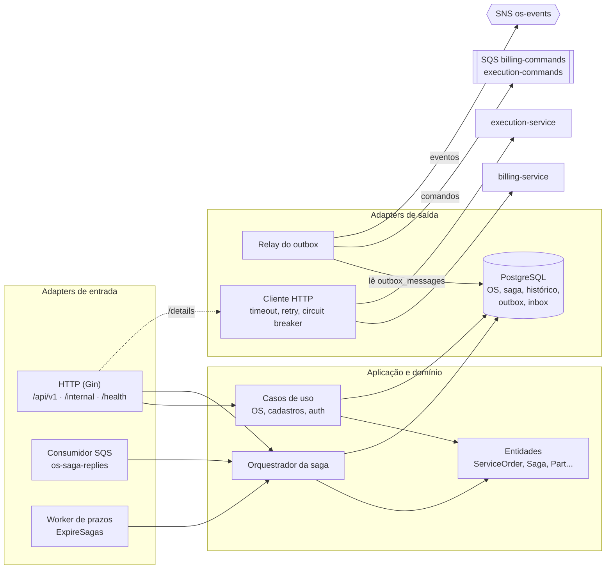
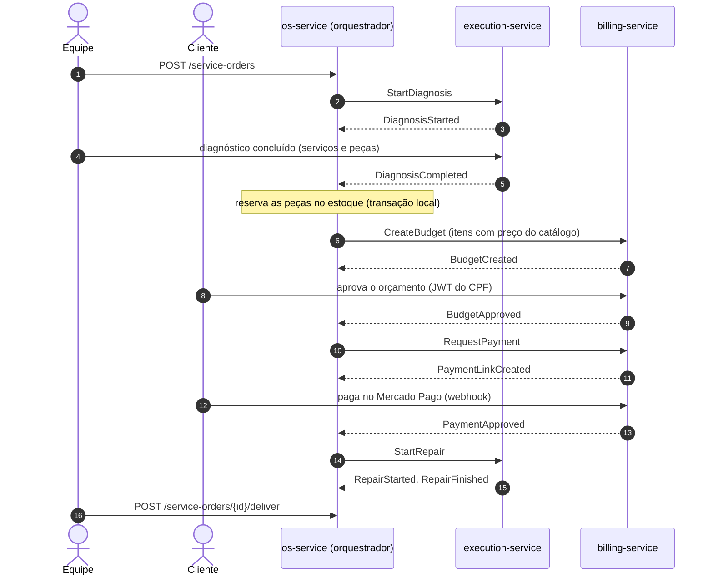

# postech-tc4-os-service

Microsserviço de **ordem de serviço (OS)** da oficina mecânica e **orquestrador da saga** que coordena orçamento, pagamento e execução entre os serviços.

Tech Challenge Fase 4, FIAP Pós Tech SOAT. O monolito da fase 3 foi dividido em microsserviços com o padrão Strangler Fig. Este repositório nasceu do monolito, com o histórico preservado, e ficou com o núcleo da OS; orçamento, pagamento e execução saíram para serviços próprios ([RFC-0004](docs/rfc/0004-decomposicao-em-microsservicos.md)).

| Repositório | Papel | Banco |
|---|---|---|
| **postech-tc4-os-service** (este) | OS, clientes, veículos, catálogo de serviços e peças, estoque; orquestrador da saga | PostgreSQL (RDS) |
| [postech-tc4-billing-service](https://github.com/Kc1t/postech-tc4-billing-service) | orçamento e pagamento com Mercado Pago | PostgreSQL (RDS) |
| [postech-tc4-execution-service](https://github.com/Kc1t/postech-tc4-execution-service) | fila de diagnóstico e reparo da oficina | DynamoDB |
| [postech-tc4-notification-lambda](https://github.com/Kc1t/postech-tc4-notification-lambda) | e-mail ao cliente a cada mudança de status | DynamoDB (deduplicação) |
| [postech-tc4-lambda-auth](https://github.com/Kc1t/postech-tc4-lambda-auth) | CPF → JWT e authorizer do API Gateway | nenhum (consulta este serviço) |
| [postech-tc4-infra-k8s](https://github.com/Kc1t/postech-tc4-infra-k8s) | EKS, API Gateway, SNS/SQS/DLQ, observabilidade, e2e local | |

## Guia rápido para avaliação

| Requisito da fase 4 | Onde está |
|---|---|
| Microsserviço com repositório, infraestrutura e banco próprios | este repo: [`infra/`](infra/) (RDS em Terraform), [`k8s/`](k8s/), [`Dockerfile`](Dockerfile) |
| Saga com compensação, escolha justificada | [Saga orquestrada](#saga-orquestrada) e [ADR-0017](docs/adr/0017-saga-orquestrada-no-os-service.md) |
| Comunicação síncrona e assíncrona | [Comunicação](#comunicação), [AsyncAPI](docs/asyncapi/asyncapi.yaml) |
| Nenhum acesso ao banco de outro serviço | a composição do `/details` usa REST; a Lambda issuer consulta `GET /internal/requesters/{document}` em vez de abrir o banco |
| Testes unitários, BDD e cobertura ≥ 80% | [Testes e cobertura](#testes-e-cobertura): **86,3%**, com o resultado de cada execução no [CI](https://github.com/Kc1t/postech-tc4-os-service/actions/workflows/ci.yml) |
| SonarQube no CI | job `sonarqube` do [CI](.github/workflows/ci.yml), quality gate próprio |
| CI/CD com deploy em Kubernetes | [CI/CD](#cicd) |
| Swagger e Postman | [`docs/swagger.yaml`](docs/swagger.yaml) e [`postman_collection.json`](postman_collection.json) |
| Segurança | [Segurança em camadas](#segurança-em-camadas) e [`docs/SEGURANCA.md`](docs/SEGURANCA.md) |
| Observabilidade | [Observabilidade](#observabilidade) |
| Decisões de arquitetura | [ADRs](docs/adr/README.md) e [RFCs](docs/rfc/README.md) |

## Responsabilidades

- Abrir a OS, guardar o status e o histórico de cada transição, e consultar a OS pelo id, pelo código ou pelo CPF do cliente.
- Manter clientes, veículos, catálogo de serviços e peças e o estoque. O estoque é reservado e devolvido pela saga.
- Orquestrar a saga da OS: mandar comandos ao execution e ao billing, reagir às respostas, compensar quando alguma etapa falha e expirar sagas paradas.
- Montar a visão completa da OS (`/details`) por API composition, juntando orçamento, pagamento e execução dos outros serviços.
- Autenticar a equipe da oficina (login, refresh com rotação, bloqueio após tentativas) e expor `GET /internal/requesters/{document}` para a Lambda issuer.

## Arquitetura do serviço

Arquitetura hexagonal ([ADR-0002](docs/adr/0002-hexagonal-architecture.md)): o domínio e os casos de uso não conhecem Gin, GORM, SQS ou HTTP.



O processo sobe o servidor HTTP e, quando a mensageria está configurada, três workers: `outbox-relay` (publica o outbox), `saga-replies-consumer` (lê `os-saga-replies`) e `saga-timeouts` (roda o `ExpireSagas`).

| Pasta | Conteúdo |
|---|---|
| `cmd/api` | `main`, injeção de dependências, rotas, middlewares |
| `internal/domain` | entidades, regras de transição de status, erros de domínio |
| `internal/application/usecase` | casos de uso; `saga/` tem o orquestrador |
| `internal/adapters` | entrada: HTTP, consumidor da fila e worker de prazos; saída: Postgres (GORM), JWT, cliente dos outros serviços |
| `pkg/` | código comum aos três serviços: `contracts` (envelope e mensagens), `messaging` (SNS/SQS com trace), `outbox`, `inbox`, `httpclient`, `observability`, `logger` |
| `features/` | cenários BDD da saga |
| `infra/` | Terraform do RDS do serviço |
| `k8s/` | manifests ([README](k8s/README.md)) |

## Saga orquestrada

### Escolha

A saga é **orquestrada**, e o orquestrador fica **dentro do os-service**, dono da OS.

- **Fluxo longo, com espera humana e dinheiro.** Entre abrir a OS e entregar o carro há diagnóstico, orçamento, decisão do cliente (horas ou dias), pagamento e reparo. Com o estado da saga persistido num lugar só (`saga_instances`), dá para responder "em que etapa a OS está e por quê" e saber exatamente o que compensar.
- **Compensação dependente da etapa.** Estornar o pagamento só vale se ele foi aprovado; devolver peças, só se foram reservadas. O orquestrador decide o plano pelo estado; na coreografia, essa regra ficaria espalhada pelos três serviços.
- **Serviços participantes simples.** Billing e execution só recebem comandos e respondem eventos. Nenhum conhece a ordem das etapas, e a saga pode mudar sem mexer neles.
- **Prazos com dono.** O orquestrador expira a aprovação em 72 h e o pagamento em 24 h e compensa sozinho.

Alternativas descartadas: **coreografia**, porque o plano de compensação e os prazos ficariam espalhados e "em que passo está a OS" exigiria correlacionar eventos de três serviços (a literatura a recomenda para sagas curtas e lineares); **orquestrador num serviço próprio**, porque cada passo mexe na OS, no histórico e no estoque, e fora do os-service cada mudança dessas viraria mais um comando e mais uma compensação; **AWS Step Functions**, porque a regra sairia do código Go e do BDD e cada espera humana viraria callback com task token. Detalhes em [ADR-0017](docs/adr/0017-saga-orquestrada-no-os-service.md); outbox, idempotência e concorrência em [ADR-0018](docs/adr/0018-outbox-inbox-e-lock-otimista.md).

### Fluxo



Cada seta entre serviços é uma mensagem: comando para a fila do serviço, evento pelo tópico do serviço até a fila `os-saga-replies`. A OS acompanha a saga: `received → in_diagnosis → awaiting_budget → awaiting_approval → awaiting_payment → in_execution → finished → delivered`, ou `cancelled`.

### Compensações

| Falha | O que o orquestrador desfaz |
|---|---|
| Diagnóstico inválido: sem itens, item fora do catálogo, quantidade inválida ou estoque insuficiente | devolve o que já foi reservado e cancela a execução |
| Orçamento não criado (`BudgetCreationFailed`) | devolve as peças e cancela a execução |
| Cliente recusa (`BudgetRejected`) | devolve as peças e cancela a execução |
| Pagamento recusado (`PaymentFailed`) | cancela o orçamento, devolve as peças e cancela a execução |
| Reparo recusado depois do pagamento (`RepairRejected`) | **estorna o pagamento** (`RefundPayment`; a saga fica em `compensating` até o `PaymentRefunded`), cancela o orçamento e devolve as peças |
| Prazo vencido: aprovação em 72 h, pagamento em 24 h (`SAGA_APPROVAL_TIMEOUT`, `SAGA_PAYMENT_TIMEOUT`) | as compensações da etapa em que parou; log `saga_expired` |
| Cancelamento pela oficina (`POST /service-orders/{id}/cancel`) | as compensações da etapa em que está |
| Pagamento aprovado depois que a saga já expirou | estorna o valor (a saga volta a `compensating` até o `PaymentRefunded`) |

Para demonstrar, com `FAULT_INJECTION_ENABLED=true`, o header `X-Simulate-Failure: budget|payment|repair` na abertura da OS faz a etapa correspondente falhar no serviço responsável; outro valor é recusado com 400.

### Garantias

- **Transactional outbox:** a mudança de estado e a mensagem a publicar são gravadas na mesma transação (`outbox_messages`); o relay publica depois. Falha de publicação espera com backoff exponencial (1 s até 5 min) sem travar as outras, e a partir da 10ª tentativa vira o log `outbox_message_stuck`.
- **Consumidor idempotente:** cada mensagem processada fica em `processed_messages`, na mesma transação do efeito; a reentrega do SQS (pelo menos uma vez) não repete efeito.
- **Concorrência:** cada passo trava a linha da saga (`SELECT ... FOR UPDATE`) antes de ler a OS, e saga e OS têm lock otimista (coluna `version`), para respostas concorrentes, cancelamento e o worker de prazos de várias réplicas não se atropelarem.
- **Ordem e duplicata:** resposta fora de etapa é registrada e ignorada (`ErrSagaOutOfStep`).
- **DLQ:** depois de 5 entregas sem sucesso a mensagem vai para `<fila>-dlq`, com alerta no New Relic, alarme no CloudWatch e [runbook](https://github.com/Kc1t/postech-tc4-infra-k8s/blob/main/docs/runbooks/dlq.md).
- **Logs de negócio depois do commit:** `saga_compensated`, os estornos e as confirmações só são logados quando a transação confirma, então o funil do dashboard não conta passo desfeito.

## Comunicação

**Assíncrona (SNS/SQS)** em tudo que é passo da saga: o os-service não espera billing nem execution responderem, e um serviço fora só atrasa a saga, sem perder mensagem ([ADR-0013](docs/adr/0013-mensageria-sns-sqs-dlq.md)). Contratos em [`pkg/contracts`](pkg/contracts) (envelope com `type`, `version`, `message_id`, `saga_id`, `os_id`, `correlation_id`; JSON Schema de cada tipo), idênticos nos quatro repositórios Go, e documentados em [AsyncAPI](docs/asyncapi/asyncapi.yaml).

| Direção | Canal | Tipos |
|---|---|---|
| envia | fila `execution-commands` | `execution.StartDiagnosis`, `execution.StartRepair`, `execution.CancelExecution` |
| envia | fila `billing-commands` | `billing.CreateBudget`, `billing.RequestPayment`, `billing.CancelBudget`, `billing.RefundPayment` |
| publica | tópico `os-events` | `os.ServiceOrderStatusChanged` (consumido pela Lambda de notificação pela fila `notification-os-events`) |
| consome | fila `os-saga-replies`, assinada nos tópicos `billing-events` e `execution-events` | `billing.BudgetCreated`, `BudgetCreationFailed`, `BudgetApproved`, `BudgetRejected`, `BudgetCancelled`, `PaymentLinkCreated`, `PaymentApproved`, `PaymentFailed`, `PaymentRefunded`; `execution.DiagnosisStarted`, `DiagnosisCompleted`, `RepairStarted`, `RepairFinished`, `RepairRejected`, `ExecutionCancelled` |

**Síncrona (REST)** só onde alguém espera a resposta:

- a API do serviço, pelo API Gateway ([API REST](#api-rest));
- a composição do `GET /service-orders/{id}/details`, que chama `GET /api/v1/budgets/os/{id}` no billing e `GET /api/v1/executions/{id}` no execution em paralelo, direto no Service do cluster, com timeout de 2 s por tentativa, até duas novas tentativas com backoff em `GET`, e circuit breaker por destino (abre com 5 falhas seguidas, por 30 s). Com uma fonte fora, a resposta sai com `partial: true` e a lista `unavailable`, em vez de erro ([ADR-0019](docs/adr/0019-api-composition-no-details.md));
- a rota interna `GET /internal/requesters/{document}`, chamada pela Lambda issuer a cada emissão de token.

## API REST

Swagger em [`docs/swagger.yaml`](docs/swagger.yaml) (servido em `/swagger/index.html`) e collection em [`postman_collection.json`](postman_collection.json), organizada pelo fluxo da saga. Erros seguem um envelope único nos três serviços: `{"error": {"code": "...", "message": "..."}}`.

| Grupo | Rotas (prefixo `/api/v1`) | Quem |
|---|---|---|
| Autenticação da equipe | `POST /auth/login`, `/auth/refresh`, `/auth/register` abertas; `POST /auth/logout` com JWT | equipe |
| Cadastros | `requesters`, `vehicles`, `services`, `parts` (CRUD) e `PATCH /parts/{id}/stock` | `admin` |
| OS e saga | `POST /service-orders`, `GET /service-orders[/{id}]`, `GET /{id}/details`, `GET /{id}/history`, `POST /{id}/cancel`, `POST /{id}/deliver`, `GET /metrics/execution-time` | `admin` |
| Cliente | `GET /service-orders/code/{code}?document=`, `GET /service-orders/requester?document=` | cliente com JWT do CPF, só as próprias OS |
| Interna | `GET /internal/requesters/{document}` (fora do `/api/v1`) | Lambda issuer, com `X-Internal-Token`; sem rota no gateway |
| Saúde | `GET /health`, `/health/live`, `/health/ready` (o `ready` testa o banco) | aberta |

## Banco de dados

PostgreSQL 16 próprio, criado pelo Terraform em [`infra/`](infra/): RDS `postech-tc4-prod-os-service-postgres`, banco `workshop`, usuário `workshop_app`, TLS obrigatório (`rds.force_ssl`), sem acesso público e com a credencial gerada pelo Terraform e guardada no Secrets Manager. Nenhum outro serviço acessa este banco ([ADR-0012](docs/adr/0012-banco-por-servico.md)).

As tabelas são criadas pelo `AutoMigrate` do GORM na subida: `users`, `refresh_tokens`, `requesters`, `vehicles`, `services`, `parts`, `service_orders` (com os itens de serviço e peça como JSON na própria linha, com o preço do momento), `service_order_status_history`, `saga_instances`, `outbox_messages` e `processed_messages`. Modelo e relacionamentos em [`docs/MODELAGEM_DE_DADOS.md`](docs/MODELAGEM_DE_DADOS.md).

## Segurança em camadas

1. **Borda:** API Gateway HTTPS com throttling (10 req/s em `POST /auth`) e Lambda authorizer em toda rota protegida, sem cache.
2. **Serviço:** o middleware `Auth` valida o JWT de novo com o mesmo segredo, `RequireRole("admin")` protege as rotas da equipe, e as rotas do cliente conferem se o `document` do token é o pedido: diferente responde 403 (`ErrDocumentMismatch`), e OS de outro cliente responde 404.
3. **Interno:** `/internal/*` fica fora do gateway e exige `X-Internal-Token`, comparado em tempo constante; sem token configurado, responde 503.
4. **Equipe:** senha com bcrypt (custo 12), bloqueio de 15 min depois de 5 erros, access token de 15 min e refresh de 7 dias com rotação.
5. **Execução:** contêiner sem root, sistema de arquivos só leitura, sem capabilities, `NetworkPolicy` só na porta 8080, banco só acessível pelo cluster.
6. **Entrega:** gosec, govulncheck, Trivy, tfsec e o quality gate do SonarQube bloqueiam o merge; segredos só em GitHub Secrets e Secrets Manager.

Modelo de ameaça, segredos, dados pessoais, testes de cada controle e limitações em [`docs/SEGURANCA.md`](docs/SEGURANCA.md).

## Testes e cobertura

| Tipo | O que cobre | Como rodar |
|---|---|---|
| Unitários | domínio, casos de uso, orquestrador, handlers HTTP, middlewares, `pkg/` | `make test` |
| Integração | repositórios, outbox e inbox contra Postgres real | `make test-db` e `make test` |
| **BDD (godog)** | [`features/saga.feature`](features/saga.feature): caminho feliz, recusa do orçamento, pagamento recusado, reparo recusado com estorno, prazo vencido, mensagem reentregue e as três falhas simuladas, contra o orquestrador real e o Postgres | `make bdd` |
| Contrato | mensagens produzidas e consumidas validadas contra os JSON Schemas de `pkg/contracts` | `make test` |
| Ponta a ponta | os três serviços, as Lambdas no LocalStack e o Mailpit: caminho feliz e três compensações | `make all` em [`postech-tc4-infra-k8s/local`](https://github.com/Kc1t/postech-tc4-infra-k8s/tree/main/local) |

**Cobertura: 86,3%** no `go test -coverprofile` (`make cover`, exclui `cmd/`, `docs/`, mocks e `scripts/`) e **83,6% no SonarQube**, com quality gate aprovado: 0 bugs, 0 vulnerabilidades, 0 code smells e 0% de duplicação. O CI reprova abaixo de 80%.

Evidência: cada execução do [workflow de CI](https://github.com/Kc1t/postech-tc4-os-service/actions/workflows/ci.yml) publica no resumo do job a cobertura do `go test` ("Cobertura do os-service") e a tabela do SonarQube com o status do gate, cobertura, bugs, vulnerabilidades, code smells, hotspots e duplicação. Abra a execução mais recente da `main` e veja o *Summary*.

## CI/CD

[`.github/workflows/ci.yml`](.github/workflows/ci.yml), independente dos outros serviços, roda em PR e push para a `main` e a `homolog`:

| Job | O que faz |
|---|---|
| `quality` | `go mod tidy` sem diff, gofmt, `go vet`, golangci-lint (inclui gosec, errorlint, bodyclose, noctx), gosec com falha a partir de severidade média, govulncheck e Swagger em dia com o código |
| `tests` | Postgres de teste, `make cover` e cobertura mínima de 80% |
| `bdd` | cenários godog da saga |
| `sonarqube` | SonarQube Community num container do job, com quality gate próprio: cobertura ≥ 80%, duplicação ≤ 3% e nota A em confiabilidade, segurança e manutenibilidade |
| `terraform` | fmt, validate e tfsec do `infra/` |
| `image` | build da imagem e Trivy (CRITICAL com correção disponível bloqueia) |
| `deploy` | só na `main`, depois de todos os anteriores: `terraform apply` do RDS, DSN lida do Secrets Manager, imagem no ECR, Secret e manifests no EKS, rollout e smoke test em `/health/ready` pelo NLB |

A `main` é protegida: só recebe PR, com os seis primeiros jobs obrigatórios e a branch atualizada, inclusive para administradores. O deploy só roda com a variável `AWS_DEPLOY_ENABLED=true`, porque as credenciais do Learner Lab expiram a cada sessão.

## Executar localmente

```bash
make test-db && make test   # Postgres de teste na porta 55432
make bdd                    # cenários da saga
docker compose -p tc4-os up -d && ./scripts/smoke-saga.sh   # só este serviço, com billing e execution simulados no LocalStack
```

O compose sobe o serviço na porta 8080, o Postgres na 5433 e o LocalStack na 4566, com a mesma topologia de filas do Terraform. Fora de produção, sem `ADMIN_EMAIL` e `ADMIN_PASSWORD`, o admin é `admin@workshop.com` / `admin123`. O fluxo completo, com os três serviços e as Lambdas, está no ambiente e2e do [postech-tc4-infra-k8s](https://github.com/Kc1t/postech-tc4-infra-k8s/tree/main/local).

## Observabilidade

- **APM e trace distribuído:** agente Go do New Relic com `nrgin`. O trace atravessa as mensagens: o publicador injeta os headers de trace nos atributos SNS/SQS, o relay reaceita o trace da requisição na transação `OutboxRelay/<tipo>` e o consumidor o continua em `Consume/<tipo>`. Uma OS aparece como um trace só, do HTTP de abertura até o reparo.
- **Banco no trace:** a conexão usa o `pgx` com o tracer `nrpgx5`, então cada consulta é um segmento de datastore e o Postgres aparece no service map.
- **Logs em contexto:** JSON com o texto em `message` e `trace.id`, `span.id`, `saga_id`, `os_id` e `correlation_id`. Os eventos de negócio da saga são logs (`saga_started`, `saga_step`, `saga_completed`, `saga_compensated`, `saga_expired`, `saga_refund_confirmed`), base do funil do dashboard.
- **Dashboard, alertas e SLOs** em Terraform no [`postech-tc4-infra-k8s/observability`](https://github.com/Kc1t/postech-tc4-infra-k8s/tree/main/observability): dashboard com as páginas Saga, Serviços, Mensageria e trace, e Lambdas; 16 alertas com runbook (erro e latência dos três serviços, taxa de compensação, saga expirada, DLQ, mensagem malformada, outbox travado, falhas da Lambda e do envio de e-mail); SLOs de disponibilidade, de latência do os-service e de OS encerradas sem compensação técnica.

## Documentação

- [ADRs](docs/adr/README.md): 0001 a 0011 das fases anteriores (com status e notas de revisão da fase 4) e, a partir da 0012, as decisões da fase 4.
- [RFCs](docs/rfc/README.md), incluindo a decomposição do monolito.
- [Segurança](docs/SEGURANCA.md), [modelagem de dados](docs/MODELAGEM_DE_DADOS.md), [diagramas](docs/diagrams/README.md) e [AsyncAPI](docs/asyncapi/asyncapi.yaml).
- Entrega da fase 4: [documento](docs/DOCUMENTO_ENTREGA_FASE4.md) e [roteiro do vídeo](docs/ROTEIRO_VIDEO_FASE4.md).
- Fases anteriores: [fase 1](docs/DOCUMENTO_ENTREGA.md), [fase 2](docs/DOCUMENTO_ENTREGA_FASE2.md), [fase 3](docs/DOCUMENTO_ENTREGA_FASE3.md), [`docs/newrelic/`](docs/newrelic/README.md) (dashboards da fase 3) e o [relatório de vulnerabilidades da fase 1](docs/security-reports/RELATORIO.md).

## Limitações conhecidas

Nenhuma delas deixa um requisito de fora; são escolhas de custo e de escopo, ou restrições do AWS Learner Lab.

- **Credenciais dos pods pela `LabRole`.** O lab não deixa criar roles, então os pods usam a `LabRole` pelo IMDS em vez de IRSA ou Pod Identity, sem menor privilégio por serviço ([ADR-0016](docs/adr/0016-credenciais-dos-pods-pela-labrole.md)).
- **Integração da conta AWS com o New Relic.** É a única peça do monitoramento que fica de fora, porque exige criar uma role IAM que o lab não permite. Ela traria as métricas do SQS e do RDS para o New Relic. O que já está coberto: os três serviços com APM, trace distribuído atravessando SNS/SQS e Postgres no trace; as três Lambdas com a layer do New Relic; logs em contexto; o alerta da DLQ no New Relic pelo log `message_failed` na última entrega antes da DLQ, além do alarme do CloudWatch na própria fila.
- **RDS Single-AZ e sem proteção contra exclusão**, por custo e porque o ambiente é recriado a cada sessão do lab ([ADR-0015](docs/adr/0015-rds-single-az-sem-deletion-protection.md)).
- **Um ambiente só na AWS.** A homologação é o e2e local, que roda os três serviços, as Lambdas e as compensações ([ADR-0021](docs/adr/0021-ambiente-unico-no-eks.md)).
- **NLB público e HTTP entre o gateway e o serviço.** A defesa é o JWT validado no serviço, a checagem de posse e o token interno; o caminho para fechar é NLB interno com VPC Link ([ADR-0007](docs/adr/0007-api-gateway-comunicacao.md)).
- **Leitura composta na hora.** O `/details` é API composition, sem CQRS: suficiente no volume atual e mais simples de manter ([ADR-0019](docs/adr/0019-api-composition-no-details.md)).
