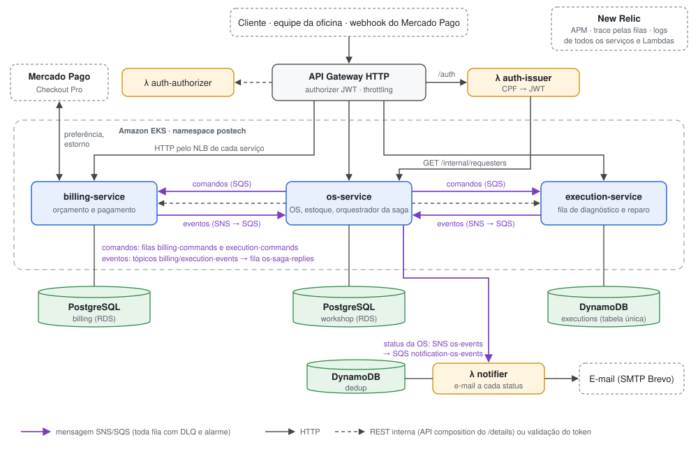

# Tech Challenge Fase 4 · Reservoir Devs

## Documento de entrega

**Grupo 112** · Pós Tech FIAP, Software Architecture (13SOAT) · Prazo: 17/11/2026

> Base do PDF submetido no Portal do Aluno. Os itens marcados com ⟨…⟩ são preenchidos depois do deploy final e da gravação do vídeo.

## 1. Grupo

| Nome | E-mail | GitHub |
|---|---|---|
| Kauã Miguel da Cunha | kauamigueldev@gmail.com | [@Kc1t](https://github.com/Kc1t) |
| Pedro Henrique Carlini de Oliveira Ribeiro | phcarlini@gmail.com | [@PedroHCarlini](https://github.com/PedroHCarlini) |
| Yuri Lopes Padlipskas | yupadlipskas@gmail.com | [@yuriLpadlipskas](https://github.com/yuriLpadlipskas) |
| Diego Oliveira Andrade Rafael | diegoliveiraa1@gmail.com | [@diegoliveiraa](https://github.com/diegoliveiraa) |

## 2. Links da entrega

| Entregável | Link |
|---|---|
| Vídeo de demonstração (até 15 min) | ⟨link do YouTube, não listado⟩ |
| API Gateway (entrada única) | ⟨endpoint do gateway⟩ |
| Swagger | `docs/swagger.yaml` em cada repositório de serviço |
| Postman | `postman_collection.json` de cada serviço |
| Dashboards do New Relic | ⟨links dos snapshots⟩ |

### Repositórios (privados, com acesso para `soat-architecture`)

| Repositório | Responsabilidade | Banco |
|---|---|---|
| [postech-tc4-os-service](https://github.com/Kc1t/postech-tc4-os-service) | Ordem de serviço, clientes, veículos, catálogo e estoque; **orquestrador da saga**; ADRs, RFCs e AsyncAPI | PostgreSQL (RDS) |
| [postech-tc4-billing-service](https://github.com/Kc1t/postech-tc4-billing-service) | Orçamento e pagamento com Mercado Pago (Checkout Pro + webhook) | PostgreSQL (RDS) |
| [postech-tc4-execution-service](https://github.com/Kc1t/postech-tc4-execution-service) | Fila de execução: diagnóstico e reparo | DynamoDB |
| [postech-tc4-notification-lambda](https://github.com/Kc1t/postech-tc4-notification-lambda) | E-mail ao cliente a cada mudança de status (serverless) | DynamoDB (deduplicação) |
| [postech-tc4-lambda-auth](https://github.com/Kc1t/postech-tc4-lambda-auth) | Autenticação por CPF (issuer) e authorizer do API Gateway | — (consulta o os-service) |
| [postech-tc4-infra-k8s](https://github.com/Kc1t/postech-tc4-infra-k8s) | EKS, API Gateway, SNS/SQS/DLQ, observabilidade, ambiente e2e local | — |

## 3. Arquitetura final

- **Síncrono (REST)**: entrada pelo API Gateway; leitura composta da OS (`/details`), em que o os-service consulta billing e execution com timeout, retry e circuit breaker; consulta do cliente pela Lambda issuer em uma rota interna.
- **Assíncrono (SNS + SQS)**: toda a saga. Comandos vão para a fila do serviço que executa; eventos saem pelo tópico do serviço que publica e chegam à fila de quem consome. Toda fila tem DLQ, alarme e runbook.
- **Nenhum serviço acessa o banco de outro.** A Lambda de autenticação, que na fase 3 abria o banco, agora consulta o os-service.

## 4. Saga: orquestração

**Escolha:** saga **orquestrada**, com o orquestrador dentro do os-service, dono da OS ([ADR-0017](https://github.com/Kc1t/postech-tc4-os-service/blob/main/docs/adr/0017-saga-orquestrada-no-os-service.md)).

**Por quê:**
- O fluxo é longo, com espera humana (aprovação do cliente), dinheiro e prazos. Um estado persistido num só lugar (`saga_instances`) responde em que etapa a OS está e o que precisa ser desfeito.
- A compensação depende da etapa: estornar só se pagou, devolver peças só se reservou. No orquestrador, essa regra é código testável (unitário e BDD); na coreografia, ficaria espalhada em três serviços.
- Billing e execution só recebem comandos e respondem eventos, sem conhecer a ordem das etapas.
- Descartamos a **coreografia** (acoplamento implícito e depuração difícil com mais de três passos), o **AWS Step Functions** (regra fora do código e do BDD, sem e2e local fiel) e um **orquestrador em serviço separado** (mais um deploy sem ganho, já que a saga existe por causa da OS).

**Fluxo:** abrir OS → `StartDiagnosis` (execution) → `DiagnosisCompleted` → reserva de peças (local) → `CreateBudget` (billing) → aprovação do cliente → `RequestPayment` (Mercado Pago) → `PaymentApproved` → `StartRepair` (execution) → `RepairFinished` → entrega.

**Compensações:**

| Falha | Compensação |
|---|---|
| Orçamento não criado ou recusado pelo cliente | devolve as peças, cancela a execução |
| Pagamento recusado | cancela o orçamento, devolve as peças, cancela a execução |
| Reparo recusado depois de pago | **estorna o pagamento**, cancela o orçamento, devolve as peças |
| Prazo vencido (aprovação 72 h, pagamento 24 h) ou cancelamento pela oficina | as da etapa em que a saga parou |

**Confiabilidade:** transactional outbox (estado e mensagem na mesma transação), consumidores idempotentes (inbox por `message_id`), `SELECT … FOR UPDATE` e lock otimista na saga, DLQ com alarme e runbook. Para a demonstração, o header `X-Simulate-Failure: budget|payment|repair` força a falha de uma etapa.

## 5. Divisão dos microsserviços e tecnologias

A divisão segue as **capacidades de negócio** do enunciado (atendimento, cobrança e execução), aplicada ao monolito da fase 3 com Strangler Fig ([RFC-0004](https://github.com/Kc1t/postech-tc4-os-service/blob/main/docs/rfc/0004-decomposicao-em-microsservicos.md)):

| Serviço | Por que existe sozinho | Por que esse banco |
|---|---|---|
| os-service | É o dono do ciclo de vida da OS e do estoque reservado, e coordena os outros. Ficou com o código e o histórico do monolito. | **PostgreSQL**: OS, estoque e saga mudam juntos em transações ACID (outbox na mesma transação). |
| billing-service | Dinheiro tem regras, integração externa (Mercado Pago) e auditoria próprias, e muda num ritmo diferente da oficina. | **PostgreSQL**: orçamento e pagamento exigem consistência forte e consultas relacionais. |
| execution-service | A fila da oficina é operacional, de alto volume de escrita e leitura por chave (OS) e por status. | **DynamoDB** (tabela única com GSI esparso da fila): acesso por chave e por status, escala sem operar servidor, e o TTL limpa sozinho o outbox e o inbox. |
| notification-lambda | Notificar é efeito colateral sem estado de negócio; serverless escala a zero e isola falhas de SMTP. | **DynamoDB** para deduplicar o envio. |
| lambda-auth | Autenticação por CPF na borda, antes de qualquer serviço. | Nenhum: consulta o os-service. |

| Camada | Tecnologia |
|---|---|
| Linguagem e HTTP | Go, Gin, arquitetura hexagonal |
| Mensageria | Amazon SNS + SQS + DLQ (LocalStack no ambiente local) |
| Bancos | Amazon RDS PostgreSQL 16 (dois), Amazon DynamoDB (dois) |
| Pagamento | Mercado Pago Checkout Pro com webhook assinado (`x-signature`); gateway fake para testes |
| Plataforma | Amazon EKS, API Gateway HTTP, Lambda, ECR, Secrets Manager, tudo em Terraform |
| CI/CD | GitHub Actions por repositório, SonarQube, golangci-lint, gosec, govulncheck, tfsec, Trivy |
| Testes | `testing` + gomock, godog (BDD), testes de componente com LocalStack, testes de contrato com JSON Schema |
| Observabilidade | New Relic (APM, trace distribuído pelas mensagens, logs em contexto, dashboards, alertas e SLOs em Terraform) |

## 6. Requisitos do enunciado

| Requisito | Como foi atendido |
|---|---|
| ≥ 3 microsserviços com repositório, infra e banco próprios | 3 serviços em EKS + 2 Lambdas; cada serviço com `infra/` (Terraform do banco), `k8s/` e `Dockerfile` |
| Pelo menos um SQL e um NoSQL | PostgreSQL (os, billing) e DynamoDB (execution, notification) |
| REST síncrono e mensageria assíncrona | REST na borda e na API composition; SNS/SQS na saga (contratos em AsyncAPI) |
| Saga com rollback e compensação | orquestrada, com compensações por etapa, prazos e estorno |
| Testes unitários, BDD, cobertura ≥ 80% | unitários em todos; BDD godog da saga no os-service; cobertura por repo na seção 7 |
| SonarQube no CI | SonarQube em container em cada pipeline, com quality gate que reprova o build |
| Pipeline independente: build, testes, qualidade, deploy em Kubernetes | um workflow por repo; deploy no EKS com rollout e smoke test |
| `main` protegida com PR e checagens | branch protection com checagens obrigatórias em todos os repositórios |
| Observabilidade da fase 3 | New Relic estendido aos novos serviços e às Lambdas, com trace atravessando as filas |
| Swagger ou Postman atualizados | os dois, em cada serviço |

## 7. Qualidade

| Repositório | Cobertura (`go test`) | SonarQube |
|---|---|---|
| os-service | ⟨86,0%⟩ | ⟨83,3%, gate aprovado⟩ |
| billing-service | ⟨96,2%⟩ | ⟨95,4%, gate aprovado⟩ |
| execution-service | ⟨95,9%⟩ | ⟨95,8%, gate aprovado⟩ |
| lambda-auth | ⟨91,3%⟩ | ⟨90,4%, gate aprovado⟩ |
| notification-lambda | ⟨91,2%⟩ | ⟨gate aprovado⟩ |

Quality gate próprio em todos: cobertura ≥ 80%, duplicação ≤ 3% e nota A em confiabilidade, segurança e manutenibilidade. Além dele, cada pipeline roda golangci-lint, gosec, govulncheck, tfsec e Trivy.

## 8. Limitações conhecidas

- O AWS Learner Lab não permite criar roles IAM: os pods usam a `LabRole` pelo IMDS em vez de IRSA, e a integração da conta AWS com o New Relic não é possível (métricas de SQS e RDS ficam no CloudWatch, com alarmes de DLQ lá).
- RDS single-AZ, um só ambiente no EKS (a homologação é o ambiente e2e local, com os mesmos serviços e Lambdas no LocalStack).
- Os NLBs dos serviços são públicos; a proteção é o JWT validado no serviço e o token interno. Fechar exigiria VPC Link com NLB interno.
- Sem CQRS: a leitura composta é feita na hora, com resposta parcial quando um serviço está fora.

## 9. Antes de submeter

- [ ] `soat-architecture` e o grupo com acesso aos seis repositórios
- [ ] Grupo trazido da fase anterior no portal
- [ ] Vídeo no YouTube (não listado) e link acima
- [ ] Endpoint do gateway, snapshots do New Relic e números de cobertura atualizados
- [ ] PDF gerado a partir deste documento
