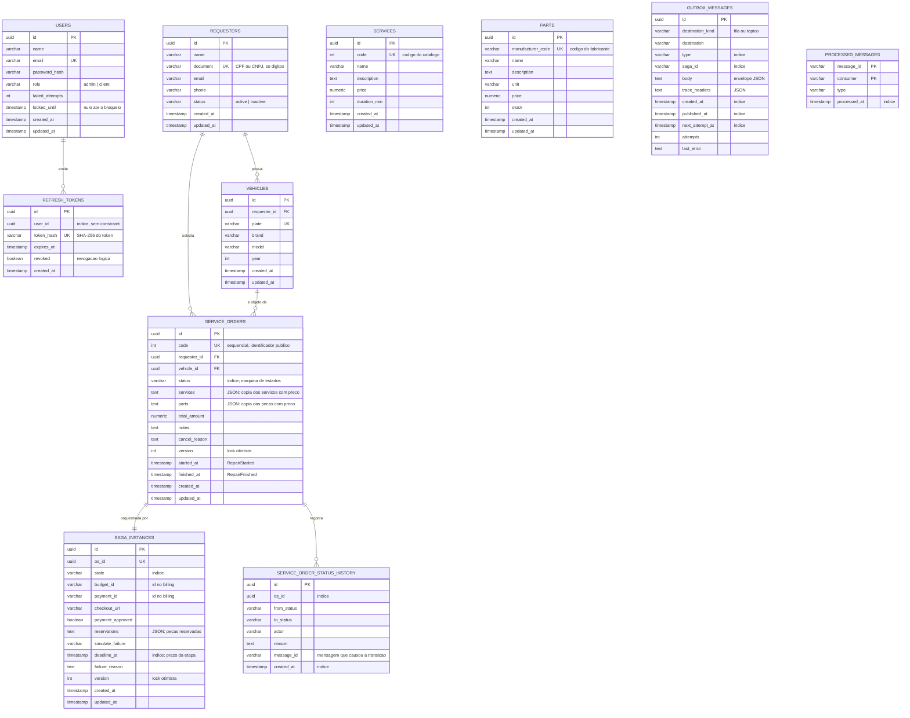
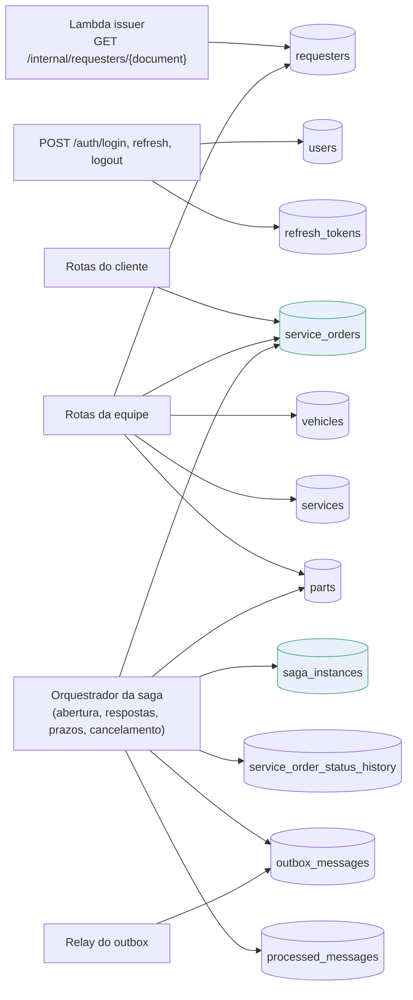

# Modelagem de dados

Banco do os-service na fase 4 · Grupo 112

Justificativa da escolha do banco, modelo relacional e relacionamentos do PostgreSQL do os-service. Na fase 4 cada serviço tem o próprio banco ([ADR-0012](adr/0012-banco-por-servico.md)): o billing-service tem outro PostgreSQL (orçamentos e pagamentos) e o execution-service usa DynamoDB, cada um documentado no próprio repositório. Nenhum serviço lê o banco de outro.

O diagrama ER está abaixo em Mermaid. As tabelas de cadastro e da OS também estão em DBML em [`database-model.dbml`](./database-model.dbml), para abrir em <https://dbdiagram.io/d>; o DBML ainda descreve `services` e `parts` da OS como `jsonb` e não traz as tabelas da saga, do outbox e do inbox.

## Diagrama ER

`SERVICES` e `PARTS` aparecem sem linha de relacionamento de propósito: são catálogos, e a OS guarda uma cópia dos itens, não uma chave estrangeira (seção 4). `SAGA_INSTANCES` e `SERVICE_ORDER_STATUS_HISTORY` se ligam à OS por `os_id`, sem constraint física. `OUTBOX_MESSAGES` e `PROCESSED_MESSAGES` são infraestrutura de mensageria, sem relação com as tabelas de negócio.

### Onde cada tabela é tocada

A Lambda de autenticação não acessa o banco: consulta o os-service pela rota interna, que lê só `requesters` ([ADR-0014](adr/0014-lambdas-fora-da-vpc.md)).

## 1. Justificativa da escolha do banco

### Por que relacional

O domínio da OS é relacional e transacional:

- Uma OS só existe amarrada a um cliente e a um veículo, e o veículo tem de pertencer àquele cliente. É integridade referencial, não regra de conveniência.
- A saga exige que o estado da saga, o status da OS, o histórico, a reserva de estoque e a mensagem a publicar mudem juntos na mesma transação (transactional outbox, [ADR-0018](adr/0018-outbox-inbox-e-lock-otimista.md)). Um banco com transação ACID entre tabelas resolve isso sem coordenação extra.
- A reserva de estoque precisa de atualização atômica do saldo, e as respostas concorrentes da saga precisam de `SELECT … FOR UPDATE` e lock otimista.
- Relatórios como o tempo médio de execução (`AVG(finished_at - started_at)`) são agregações que o SQL faz direto.

### Por que PostgreSQL

| Critério | Peso na decisão |
|---|---|
| **Continuidade** | As fases 1 a 3 já rodavam PostgreSQL 16, com os testes de repositório contra Postgres real. |
| **JSON** | Os itens da OS e as reservas da saga são gravados como JSON numa coluna `text`, e o Postgres consulta esse JSON quando precisa (`::jsonb @>` na checagem de cadastro em uso). |
| **`FOR UPDATE SKIP LOCKED`** | Várias réplicas do relay do outbox leem lotes diferentes sem se bloquear. |
| **`gen_random_uuid()` nativo** | Chaves UUID geradas pelo banco, sem extensão, desde o PG 13. |
| **Gerenciado** | Amazon RDS em todas as fases, com backup, criptografia em repouso, Performance Insights e TLS obrigatório. |
| **Custo** | `db.t3.micro` Single-AZ com 20 GB gp3 é a menor instância que atende ([ADR-0015](adr/0015-rds-single-az-sem-deletion-protection.md)). |

### Alternativas avaliadas e descartadas

| Alternativa | Por que não |
|---|---|
| **DynamoDB, como o execution-service** | A OS precisa de transação entre OS, saga, histórico, estoque e outbox, de unicidade de CPF, placa e código, e de agregações por status e data. No execution, o acesso é por chave e por status, e lá o DynamoDB serve ([ADR-0012](adr/0012-banco-por-servico.md)). |
| **MySQL ou Aurora MySQL** | Sem ganho para este domínio, e custaria reescrever os testes de repositório. |
| **Aurora Serverless v2** | O piso de custo por ACU é maior que o de uma `db.t3.micro`, e o tráfego é de demonstração. |
| **PostgreSQL em contêiner no cluster** | Jogaria backup, HA e patching para o time, e o banco morreria com o nó. |

O provisionamento fica em [`infra/`](../infra/) neste repositório, aplicado pelo pipeline do serviço: RDS `postech-tc4-prod-os-service-postgres`, banco `workshop`, usuário `workshop_app`, `rds.force_ssl = 1`, sem acesso público e com a senha gerada pelo Terraform no Secrets Manager.

## 2. Mudanças no modelo

### 2.1 Fase 4: tabelas da saga e da mensageria

| Mudança | Por quê |
|---|---|
| `saga_instances`, uma linha por OS (`os_id` único) | estado do orquestrador: etapa, ids do orçamento e do pagamento no billing, peças reservadas, prazo da etapa (`deadline_at`, lido pelo worker de prazos) e motivo da falha |
| `service_order_status_history` | trilha de cada transição, com quem a causou (`actor`) e a mensagem de origem (`message_id`); é o que o `GET /service-orders/{id}/history` devolve |
| `outbox_messages` | comandos e eventos gravados na transação do passo e publicados depois pelo relay, com tentativas, próxima tentativa e último erro |
| `processed_messages` (chave `message_id` + `consumer`) | inbox: a reentrega do SQS não repete efeito; retenção de 21 dias, maior que os 14 dias da DLQ |
| `service_orders.version` e `saga_instances.version` | lock otimista: o `UPDATE` só passa com a versão lida, senão `ErrConcurrentUpdate` |
| `service_orders.cancel_reason` | motivo da compensação ou do cancelamento, mostrado no `/details` |
| status `awaiting_budget`, `awaiting_payment` e `cancelled` | etapas novas da saga; o orçamento e o pagamento saíram para o billing-service |
| `started_at` e `finished_at` gravados pelas respostas `RepairStarted` e `RepairFinished` | o reparo acontece no execution-service; a métrica de tempo de execução continua no os-service |

O outbox apaga mensagens publicadas depois de 7 dias e o inbox apaga registros depois de 21 dias; a limpeza roda no próprio relay.

### 2.2 Fase 3: `requesters.status`

`requesters` ganhou `status varchar not null default 'active'` (`active | inactive`), porque a autenticação por CPF precisa saber se o cliente existe e se está apto. Na fase 4 essa leitura é feita pela rota interna do os-service, e a Lambda responde 403 quando o cliente existe mas está inativo, separado do 404 de inexistente. O `default 'active'` manteve as linhas antigas autenticando depois do `AutoMigrate`, sem backfill.

## 3. Relacionamentos

| Relação | Cardinalidade | Regra |
|---|---|---|
| `users` → `refresh_tokens` | 1:N | Cada login e cada refresh gravam um token novo; a revogação é lógica (`revoked`). A chave é lógica: o model não declara associação, então o `AutoMigrate` cria só o índice em `user_id`. |
| `requesters` → `vehicles` | 1:N | Chave estrangeira física. Excluir um cliente com veículo responde 409 `RESOURCE_IN_USE`. |
| `requesters` → `service_orders` | 1:N | Chave estrangeira física. A OS é registro histórico e financeiro. |
| `vehicles` → `service_orders` | 1:N | Chave estrangeira física. Excluir um veículo com OS responde 409 `RESOURCE_IN_USE`. |
| `service_orders` → `saga_instances` | 1:1 | Por `os_id` único, sem constraint física. A saga nasce na mesma transação da OS. |
| `service_orders` → `service_order_status_history` | 1:N | Por `os_id` indexado, sem constraint física. |

**Nota de implementação:** o tag `constraint:OnDelete:RESTRICT` está no campo de ID (`model/vehicle.go`, `model/serviceorder.go`), mas o GORM lê restrições no campo da associação. A chave estrangeira pode ter nascido com o padrão do PostgreSQL, `NO ACTION`, que também recusa o `DELETE` de um registro com filhos; a diferença para `RESTRICT` é só o momento da checagem. Nos dois casos a violação (`23503`) vira `ErrInUse` no adapter e 409 na API.

**Por que recusar e não cascatear:** a OS é documento de cobrança e histórico de manutenção do veículo. Cascatear a exclusão apagaria esse histórico a partir de um `DELETE /requesters/{id}`. Excluir cliente com vínculo falha de forma explícita, e o caminho é desativar (`status = inactive`).

**Catálogo em uso:** `services` e `parts` não têm chave estrangeira para a OS. Antes de excluir, o caso de uso confere se alguma OS que não está entregue nem cancelada usa o item (`ExistsActiveWithService`, `ExistsActiveWithPart`, consulta `::jsonb @>` sobre as colunas de itens) e responde 409 `RESOURCE_IN_USE`. Sem isso, a compensação da saga falharia ao devolver ao estoque uma peça que não existe mais. OS entregues ou canceladas não prendem o catálogo, porque guardam a cópia do item.

**Índices além das PKs:**

| Índice | Motivo |
|---|---|
| `requesters.document` (único) | impede CPF/CNPJ duplicado e é o caminho da rota interna usada pela Lambda |
| `vehicles.plate` (único) | placa é o identificador natural do veículo |
| `vehicles.requester_id` | `GET /requesters/{id}/vehicles` |
| `service_orders.code` (único, sequencial) | código público da OS, usado na consulta do cliente sem expor o UUID |
| `service_orders.requester_id` | listagem de OS por cliente |
| `service_orders.status` | listagem por status e métricas |
| `saga_instances.os_id` (único) | uma saga por OS; é a linha travada com `FOR UPDATE` em cada passo |
| `saga_instances.state`, `saga_instances.deadline_at` | o worker de prazos busca sagas em espera com prazo vencido |
| `service_order_status_history.os_id`, `created_at` | histórico de uma OS em ordem |
| `outbox_messages.published_at`, `next_attempt_at`, `created_at` | o relay busca as pendentes prontas para nova tentativa, em ordem |
| `processed_messages.processed_at` | limpeza do inbox por idade |
| `refresh_tokens.token_hash` (único) | busca na renovação de sessão |
| `refresh_tokens.user_id` | revogação de todas as sessões de um usuário no logout |
| `services.code`, `parts.manufacturer_code` (únicos) | códigos do catálogo, sem item duplicado |

## 4. Itens da OS como cópia

`service_orders.services` e `service_orders.parts` guardam cópia de descrição, preço e quantidade no momento em que o diagnóstico é aceito, e não referências vivas a `services` e `parts`. O GORM grava esses campos com `serializer:json` numa coluna `text`.

É uma desnormalização deliberada. Se a oficina reajustar o preço de uma peça, o total de uma OS já orçada não pode mudar: ele precisa bater com o orçamento enviado ao billing e com o que o cliente pagou. A alternativa normalizada seria uma tabela de versões de preço com validade, desproporcional para o volume do sistema. O `service_id` e o `part_id` continuam dentro da cópia, o que preserva a ligação com o catálogo e permite a checagem de cadastro em uso.

## 5. Estratégia de migration

O schema é aplicado pelo `AutoMigrate` do GORM na subida (`internal/adapters/outbound/postgresql/migrate.go`), a partir dos modelos em `internal/adapters/outbound/postgresql/model`, de `pkg/outbox` e de `pkg/inbox`.

O `AutoMigrate` cria tabelas, colunas e índices que faltam, mas não remove nem altera colunas existentes. Todas as mudanças da fase 4 foram aditivas (tabelas novas, colunas com default), então couberam nesse limite. Mudanças destrutivas (renomear ou remover coluna, trocar tipo) exigiriam migrations versionadas, como as do billing-service, e uma ADR própria.
