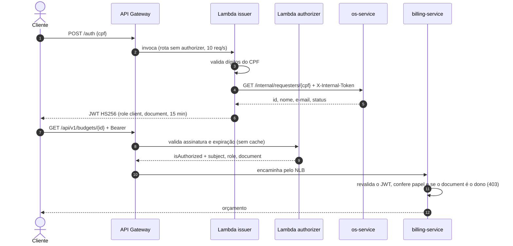

# Segurança

Controles de segurança da oficina nos seis repositórios `postech-tc4-*`, conferidos no código e no Terraform em 1º/11/2026. Cada controle aponta para onde está implementado e para o teste que o prova. As decisões por trás estão nas ADRs [0005](adr/0005-jwt-refresh-token.md), [0007](adr/0007-api-gateway-comunicacao.md), [0014](adr/0014-lambdas-fora-da-vpc.md), [0016](adr/0016-credenciais-dos-pods-pela-labrole.md) e [0020](adr/0020-mercado-pago-checkout-pro.md) e na [RFC-0003](rfc/0003-autenticacao-por-cpf.md).

| Camada | Controle principal |
|---|---|
| Borda | API Gateway HTTPS com throttling, Lambda authorizer em toda rota protegida, cache do authorizer desligado |
| Serviço | cada serviço revalida o JWT (só HS256, `exp` obrigatório), confere o papel por rota e a posse do recurso (403) |
| Entrada | id que não é UUID, código e CPF/CNPJ inválidos recusados com 400 antes do caso de uso e do banco |
| Interno | `/internal/*` fora do gateway, com `X-Internal-Token` comparado em tempo constante; JWT de serviço de 2 minutos entre serviços |
| Pagamento | webhook do Mercado Pago com HMAC `x-signature` e releitura do pagamento no provedor |
| Dados | TLS obrigatório no RDS, banco sem acesso público, CPF e e-mail mascarados nos logs das Lambdas e do billing |
| Execução | contêiner sem root, sistema de arquivos só leitura, sem capabilities, `NetworkPolicy` |
| Cadeia de entrega | golangci-lint com gosec, gosec, govulncheck, Trivy, tfsec, kubeconform, quality gate do SonarQube, `main` protegida |

## 1. Modelo de ameaça

**Ativos:** dados pessoais do cliente (nome, CPF ou CNPJ, e-mail, telefone), o dinheiro do pagamento e do estorno, o estado da OS e da saga, e os segredos (`JWT_SECRET`, `INTERNAL_API_TOKEN`, senhas de banco, credenciais do Mercado Pago e do SMTP).

| Quem | Como entra | O que pode fazer | Ameaça principal | Controles |
|---|---|---|---|---|
| Equipe da oficina | e-mail e senha em `POST /api/v1/auth/login` (os-service), JWT `role: admin` | cadastros, abrir, cancelar e entregar OS, ver o `/details`, operar a fila do mecânico, simular pagamento | força bruta de senha, token roubado | bcrypt, bloqueio após 5 erros, access token de 15 min, refresh rotativo ([seção 2.4](#24-login-da-equipe-no-os-service)) |
| Cliente | CPF em `POST /auth` (Lambda issuer), JWT `role: client` com claim `document` | consultar as próprias OS, ver, aprovar ou recusar o próprio orçamento, ver o próprio pagamento | CPF é dado público; enumeração de CPF; ler a OS de outro cliente | limite de 10 req/s em `POST /auth`, token de 15 min só com papel `client`, posse conferida em cada serviço ([seção 3](#3-autorização)) |
| os-service chamando billing e execution | `GET` direto no Service ClusterIP, com JWT de serviço | ler orçamento, pagamento e execução para o `/details` | uso do token fora do propósito | token de 2 min, assinado na hora, só nas chamadas da composição ([seção 3.4](#34-chamadas-entre-serviços)) |
| Lambda issuer chamando o os-service | `GET /internal/requesters/{document}` pelo NLB, com `X-Internal-Token` | ler id, nome, e-mail, documento e status de um cliente | chamada sem o token, força bruta do token | rota fora do gateway, comparação em tempo constante, 503 se o servidor não tem token ([seção 3.3](#33-token-interno)) |
| Mercado Pago | `POST /api/v1/webhooks/mercadopago`, rota pública | avisar que um pagamento mudou | notificação forjada ou repetida aprovando reparo sem pagamento | HMAC `x-signature`, releitura do pagamento no provedor, máquina de estados ([seção 4](#4-webhook-do-mercado-pago)) |
| Mensageria (SNS/SQS) | só principals da conta; a fila só aceita o SNS dos tópicos que assina | comandos e eventos da saga | mensagem duplicada, fora de ordem ou malformada | inbox idempotente, checagem de etapa na saga, DLQ ([ADR-0018](adr/0018-outbox-inbox-e-lock-otimista.md)) |

## 2. Autenticação em camadas

### 2.1 Lambda issuer (CPF → JWT)

[`postech-tc4-lambda-auth/internal/issuer/handler.go`](https://github.com/Kc1t/postech-tc4-lambda-auth/blob/main/internal/issuer/handler.go)

- Valida o CPF pelos dígitos verificadores antes de qualquer consulta, recusando tamanho errado e sequências repetidas (400).
- Consulta o cliente no os-service pela rota interna. Inexistente → 404, `status` diferente de `active` → 403, os-service fora → 503, resposta inesperada → 500. Até duas tentativas, cada uma com timeout de 3 s, só em erro de rede e 5xx.
- Emite JWT HS256 com `sub` (id do cliente), `role: client`, `email`, `name`, `document`, `iat` e `exp`. Validade `JWT_TTL`, padrão 15 minutos, sem refresh.
- A resposta leva `Cache-Control: no-store`. O log grava o documento mascarado.

### 2.2 Lambda authorizer no API Gateway

[`postech-tc4-lambda-auth/internal/authorizer/handler.go`](https://github.com/Kc1t/postech-tc4-lambda-auth/blob/main/internal/authorizer/handler.go) e [`postech-tc4-infra-k8s/api_gateway.tf`](https://github.com/Kc1t/postech-tc4-infra-k8s/blob/main/api_gateway.tf)

- Authorizer `REQUEST` em todas as rotas com `auth = true` do mapa de rotas. O Terraform só cria uma rota protegida quando o authorizer existe; sem ele, a rota não é criada, em vez de ficar aberta.
- Aceita só HS256 (`jwt.WithValidMethods`), recusa `alg: none`, valida a expiração e exige `sub` e `role`. O header `Authorization` é lido sem diferenciar maiúsculas.
- `authorizer_result_ttl_in_seconds = 0`: cada requisição é validada de novo.
- Devolve `subject`, `role` e `document` no contexto da requisição. Aceita o token do cliente e o da equipe, porque os dois usam o mesmo `JWT_SECRET`.
- Rotas abertas no gateway: `GET /health`, `POST /auth`, `POST /api/v1/auth/{proxy+}` (login e refresh da equipe; o logout e o registro passam pelo gateway, mas exigem JWT no os-service), `GET /fake-checkout/{proxy+}` e o webhook do Mercado Pago.

### 2.3 Cada serviço revalida o JWT

O gateway não é a única barreira: o NLB de cada serviço é público, então cada serviço valida o token de novo com o mesmo `JWT_SECRET` e só depois confere papel e posse.

| Componente | Algoritmo aceito | `exp` | Claims exigidas | Código |
|---|---|---|---|---|
| os-service | só HS256 | obrigatório (`WithExpirationRequired`) | `sub` e `role` | [`cmd/api/middleware/auth.go`](../cmd/api/middleware/auth.go) |
| billing-service | só HS256 | obrigatório (`WithExpirationRequired`) | `sub` e `role` válido | [`cmd/api/middleware/auth.go`](https://github.com/Kc1t/postech-tc4-billing-service/blob/main/cmd/api/middleware/auth.go) |
| execution-service | só HS256 | obrigatório (`WithExpirationRequired`) | `sub` e `role` válido | [`cmd/api/middleware/auth.go`](https://github.com/Kc1t/postech-tc4-execution-service/blob/main/cmd/api/middleware/auth.go) |
| authorizer | só HS256 | obrigatório (`WithExpirationRequired`) | `sub` e `role` | [`internal/token/token.go`](https://github.com/Kc1t/postech-tc4-lambda-auth/blob/main/internal/token/token.go) |

O critério é o mesmo nas quatro camadas: token assinado com outro algoritmo (HS384, HS512, `alg: none`) ou sem `exp` é recusado. Os emissores (login do os-service, issuer e o token de serviço) sempre gravam `exp`. Os três serviços recusam subir em produção com o `JWT_SECRET` padrão ou vazio (no os-service, `Config.Validate`, teste `TestValidate_RecusaSegredoPadraoEmProducao`).

### 2.4 Login da equipe no os-service

[`internal/application/usecase/auth/`](../internal/application/usecase/auth/), detalhes na [ADR-0005](adr/0005-jwt-refresh-token.md)

- Senha com bcrypt, custo `BCRYPT_COST=12` ([`pkg/hasher/bcrypt.go`](../pkg/hasher/bcrypt.go)).
- A senha é comparada mesmo quando o e-mail não existe, contra um hash fictício, para o tempo de resposta não revelar quais e-mails existem.
- Depois de 5 erros seguidos (`MAX_FAILED_LOGINS`), a conta fica bloqueada por 15 minutos (`LOGIN_LOCK_MIN`). Conta bloqueada recebe o mesmo 401 de senha errada.
- Access token HS256 de 15 minutos com `sub`, `email` e `role`. Refresh token de 7 dias, 32 bytes aleatórios, guardado só como SHA-256 em `refresh_tokens`. Cada uso revoga o refresh antigo e grava o novo na mesma transação (`RotateToken`); um refresh já usado recebe 401.
- `POST /api/v1/auth/logout` revoga todos os refresh tokens do usuário.
- `POST /api/v1/auth/register` exige JWT de `admin` e cria outro usuário da equipe, com papel `admin` ([ADR-0023](adr/0023-registro-restrito-a-equipe.md)). A rota passa pelo gateway sem authorizer (`POST /api/v1/auth/{proxy+}`), então a barreira é o JWT validado no os-service. Até a fase 4 ela era pública e criava usuário `client` sem `document`, que não acessava nada mas permitia escrita anônima em `users`. O cliente não se cadastra: autentica pelo CPF na Lambda issuer. O primeiro `admin` é criado na subida a partir de `ADMIN_EMAIL` e `ADMIN_PASSWORD`; em produção, sem os dois, o seed não roda.

## 3. Autorização

### 3.1 Papéis por rota

| Serviço | Rotas | Quem passa |
|---|---|---|
| os-service | `POST /api/v1/auth/login`, `/refresh`; `/health`, `/health/live`, `/health/ready`; `/swagger/*` | aberta |
| os-service | `POST /api/v1/auth/logout` | qualquer JWT válido |
| os-service | `GET /api/v1/service-orders/code/{code}?document=`, `GET /api/v1/service-orders/requester?document=` | JWT com `document` igual ao pedido; JWT `admin` sem `document` |
| os-service | `POST /api/v1/auth/register`; `requesters`, `vehicles`, `services`, `parts` (CRUD, `PATCH /parts/{id}/stock`), `service-orders` (abrir, listar, detalhar, histórico, cancelar, entregar, métrica de tempo) | `admin` |
| os-service | `GET /internal/requesters/{document}` | `X-Internal-Token` |
| billing-service | `GET /api/v1/budgets/os/{os_id}`, `GET /api/v1/budgets/{id}`, `GET /api/v1/payments/{id}` | `admin` ou `client` dono |
| billing-service | `POST /api/v1/budgets/{id}/approve`, `/reject` | só o `client` dono |
| billing-service | `POST /api/v1/payments/{id}/simulate` | `admin`, e só com `PAYMENT_GATEWAY=fake` (fora dele, 403 `SIMULATION_DISABLED`) |
| billing-service | `POST /api/v1/webhooks/mercadopago`; `GET /fake-checkout/{payment_id}` (só com o fake) | aberta (o webhook é autenticado pela assinatura) |
| execution-service | todas em `/api/v1/executions` (fila, consulta, início e fim de diagnóstico e de reparo) | `admin` ou `mechanic`; `client` recebe 403 |

Papel fora da lista recebe 403 `FORBIDDEN`. O papel `mechanic` existe no execution-service, mas nenhum emissor o gera hoje; a equipe usa `admin`.

### 3.2 Posse do recurso

O papel não basta: o cliente só vê o que é dele.

- **os-service:** `authorizeDocument` ([`ownership.go`](../internal/adapters/inbound/http/service_order/ownership.go)) compara o `document` do token com o pedido na query. Diferente, ausente ou token de cliente sem `document` → `ErrDocumentMismatch`, 403 `FORBIDDEN`. Na consulta por código, o caso de uso ainda confere se a OS é daquele cliente e responde 404 se não for, sem revelar que o código existe ([`get_by_code.go`](../internal/application/usecase/service_order/get_by_code.go)).
- **billing-service:** `Budget.CheckReadAccess` e `CheckDecisionAccess` ([`access.go`](https://github.com/Kc1t/postech-tc4-billing-service/blob/main/internal/domain/entities/access.go)) devolvem `ErrNotOwner`, 403 `FORBIDDEN`, quando o documento do token não é o do orçamento. A comparação normaliza o documento e exige papel `client` com `document` preenchido. O `admin` lê qualquer orçamento, mas não aprova nem recusa: a decisão é só do cliente dono.

### 3.3 Token interno

[`internal/adapters/inbound/http/internalapi/handler.go`](../internal/adapters/inbound/http/internalapi/handler.go)

- `/internal/requesters/{document}` exige `X-Internal-Token`, comparado com `crypto/subtle.ConstantTimeCompare`. Ausente ou errado → 401; servidor sem `INTERNAL_API_TOKEN` configurado → 503 `INTERNAL_API_DISABLED`, em vez de liberar a rota.
- Não tem rota no API Gateway. Só é alcançável de dentro do cluster e pelo NLB do os-service.
- Responde só os cinco campos que a emissão de token precisa: `id`, `name`, `email`, `document`, `status`.
- O token é compartilhado pelo os-service e pela Lambda issuer.

### 3.4 Chamadas entre serviços

Na composição do `/details` ([ADR-0019](adr/0019-api-composition-no-details.md)), o os-service assina na hora um JWT de serviço (`sub = service:os-service`, `role: admin`, 2 minutos) e chama o billing e o execution direto no Service ClusterIP, sem passar pelo gateway. Os dois validam esse token com o mesmo middleware da equipe.

### 3.5 Validação de entrada

Entrada inválida para no handler com 400, antes do caso de uso e do banco, em vez de virar 404 ou 500. As checagens de identificador rodam depois da autenticação e do papel, então quem não tem acesso continua recebendo 401 ou 403.

| Serviço | Entrada | Resposta |
|---|---|---|
| os-service | `{id}` que não é UUID em `service-orders`, `requesters`, `vehicles`, `services` e `parts` (middleware `httputil.UUIDParams`) | 400 `VALIDATION_ERROR`, "path parameter 'id' must be a valid UUID" |
| os-service | id que escapa do middleware e chega ao Postgres como texto inválido para UUID (`22P02`) | 400 `VALIDATION_ERROR` (`ErrInvalidID`), segunda barreira no adapter |
| os-service | `GET /service-orders/code/{code}` com código não numérico ou ≤ 0 | 400 `VALIDATION_ERROR` |
| os-service | CPF/CNPJ com dígito verificador errado em `GET /requesters/document/{document}` e no `?document=` das rotas do cliente | 400; o documento formatado (`529.982.247-25`) é normalizado |
| os-service | corpo JSON inválido ou sem campo obrigatório | 400 `VALIDATION_ERROR` |
| os-service | `X-Simulate-Failure` fora de `budget`, `payment` e `repair` (com a injeção de falhas ligada) | 400 `INVALID_SIMULATE_FAILURE` |
| os-service | `DELETE` de id inexistente | 404 |
| os-service | excluir serviço ou peça usado por OS ativa, ou cliente ou veículo com OS | 409 `RESOURCE_IN_USE`; o serviço e a peça são conferidos antes, e a violação de chave estrangeira (`23503`) vira `ErrInUse` |
| billing-service | id de orçamento ou de pagamento que não é UUID | 400 `INVALID_REQUEST`; `GET /budgets/os/{os_id}` aceita qualquer valor, porque a chave é do os-service |
| execution-service | `os_id` que não é UUID na consulta e nas quatro transições | 400 `VALIDATION_ERROR`, sem consultar o DynamoDB |
| Lambda issuer | corpo que não é JSON, CPF com tamanho errado, sequência repetida ou dígito errado | 400 |
| Consumidores SQS | envelope que não decodifica, sem `message_id` ou `type`, ou de versão maior que a suportada | log `message_malformed` com alerta; a mensagem não é removida e vai para a DLQ depois de 5 entregas |

## 4. Webhook do Mercado Pago

[`signature.go`](https://github.com/Kc1t/postech-tc4-billing-service/blob/main/internal/adapters/outbound/mercadopago/signature.go) e [`webhook/handler.go`](https://github.com/Kc1t/postech-tc4-billing-service/blob/main/internal/adapters/inbound/http/webhook/handler.go) no billing-service; decisão na [ADR-0020](adr/0020-mercado-pago-checkout-pro.md)

1. Notificação sem `data.id` ou de tipo diferente de `payment` recebe 200 `ignored` e não tem efeito.
2. O header `x-signature` é separado em `ts` e `v1`. O manifest `id:{data.id};request-id:{x-request-id};ts:{ts};` é assinado com HMAC-SHA256 e `MP_WEBHOOK_SECRET`, e comparado com `v1` por `hmac.Equal`.
3. Assinatura ausente ou inválida → 401 `INVALID_SIGNATURE`. Sem `MP_WEBHOOK_SECRET`, toda notificação é recusada. Com `PAYMENT_GATEWAY=mercadopago`, o serviço não sobe sem o segredo.
4. Janela de tempo: `MP_WEBHOOK_MAX_AGE` recusa `ts` mais antigo (ou mais no futuro) que o limite. O padrão é 0, desligado.
5. O corpo nunca é a fonte da verdade. Com a assinatura válida, o billing relê o pagamento em `GET /v1/payments/{id}` e só então aplica o resultado.

**Idempotência:**

- A reentrega de um resultado já aplicado (mesmo ID de pagamento do provedor, pagamento já encerrado) é ignorada.
- Aprovação com valor diferente do cobrado vira `PaymentFailed` e o pagamento é estornado. Aprovação que chega para um pagamento já encerrado também é estornada.
- Conflito de concorrência responde 409 e falha transitória responde 5xx; o Mercado Pago reentrega.
- O estorno usa `X-Idempotency-Key`, a mesma em todas as tentativas, então o provedor estorna uma vez só.

## 5. Segredos

| Segredo | Origem | Onde chega | Quem usa |
|---|---|---|---|
| `JWT_SECRET` | gerado por `scripts/setup-github.sh app` (48 caracteres aleatórios), GitHub Secret | Secret Kubernetes `<serviço>-secret`; variável de ambiente das Lambdas pelo Terraform | os, billing, execution, issuer, authorizer |
| `INTERNAL_API_TOKEN` | gerado pelo mesmo script | Secret do os-service; variável da Lambda issuer | os-service, issuer |
| `ADMIN_PASSWORD` | gerado pelo mesmo script | Secret do os-service | seed do admin |
| Senha do RDS e `POSTGRES_DSN` | `random_password` no Terraform do serviço | Secrets Manager (`postech-tc4-prod-<serviço>-db-credentials`); o job de deploy lê a DSN, mascara no log (`::add-mask::`) e grava no Secret do serviço | os, billing |
| `MP_ACCESS_TOKEN`, `MP_WEBHOOK_SECRET` | GitHub Secret (`scripts/setup-github.sh mercadopago`) | Secret do billing | billing |
| `SMTP_USERNAME`, `SMTP_PASSWORD` | GitHub Secret | variável de ambiente da Lambda notifier | notifier |
| `NEW_RELIC_LICENSE_KEY` | GitHub Secret | Secret dos serviços; variável das Lambdas | todos |
| Credenciais AWS | sessão do Learner Lab, GitHub Secret atualizado por `scripts/setup-github.sh aws` | só o pipeline | CI/CD |

- **Nada no repositório.** [`k8s/secret.yaml`](../k8s/secret.yaml) é um modelo com `CHANGE_ME`; o pipeline cria o Secret com `kubectl create secret --from-literal` e confere que nenhum `_PLACEHOLDER` sobrou nos manifests. O `.env.example` não tem valores reais.
- **Pods sem chave AWS.** Os serviços usam a cadeia padrão da SDK e recebem a credencial da `LabRole` pelo IMDSv2 do nó ([ADR-0016](adr/0016-credenciais-dos-pods-pela-labrole.md)).
- **State do Terraform** num bucket S3 com versionamento, bloqueio de acesso público e criptografia SSE, criado por `scripts/setup-github.sh state`. O state guarda a senha do RDS e as variáveis sensíveis das Lambdas.
- **Limitações do Learner Lab:** não é possível criar role IAM nem chave KMS gerenciada pelo cliente. Por isso a `LabRole` é compartilhada, Secrets Manager, RDS, DynamoDB e CloudWatch Logs usam a chave gerenciada da AWS, os tópicos SNS ficam sem criptografia em repouso e os Secrets do EKS não têm criptografia por CMK. Cada exceção está anotada no Terraform com `tfsec:ignore` e o motivo ([seção 8](#8-cadeia-de-ci)).

## 6. Dados pessoais (LGPD)

| Dado | Onde fica | Por quê |
|---|---|---|
| Nome, CPF/CNPJ, e-mail, telefone | `requesters` no RDS do os-service | cadastro do cliente |
| Nome, documento e e-mail do cliente | `budgets` no RDS do billing (cópia recebida no `CreateBudget`) | posse do orçamento e dados do checkout |
| Nome, documento e e-mail | evento `os.ServiceOrderStatusChanged` no SNS `os-events` e na fila `notification-os-events` | e-mail de mudança de status |
| `message_id` | tabela de dedup da Lambda notifier, com TTL de 7 dias | idempotência do envio |

Mascaramento nos logs (os dois últimos dígitos do documento, a primeira letra do e-mail):

| Onde | Função | O que mascara |
|---|---|---|
| Lambda issuer | [`internal/mask`](https://github.com/Kc1t/postech-tc4-lambda-auth/blob/main/internal/mask/mask.go) | documento em todo log depois da validação |
| Lambda notifier | [`internal/mask`](https://github.com/Kc1t/postech-tc4-notification-lambda/blob/main/internal/mask/mask.go) | destinatário do e-mail e documento do cliente sem e-mail |
| billing-service | [`entities.MaskDocument`](https://github.com/Kc1t/postech-tc4-billing-service/blob/main/internal/domain/entities/document.go) | documento no log de criação do orçamento |

O os-service não registra dados do cliente como atributo de log. O log de acesso grava o caminho sem a query string, então o `?document=` das rotas de cliente fica de fora. Nas duas rotas que têm o documento no caminho (`/internal/requesters/{document}` e `/api/v1/requesters/document/{document}`), o log grava o template da rota em vez do caminho ([`logging.go`](../cmd/api/middleware/logging.go), teste `TestRequestLogger_NaoLogaDocumentoDoCaminho`). Em todo log de acesso, o campo `route` traz o template. O authorizer loga `subject` e `role`, não o documento. O access log do API Gateway grava a rota (`routeKey`), o IP e o status, não o caminho nem o corpo.

## 7. Borda e rede

- **TLS na borda.** O endpoint do API Gateway só aceita HTTPS.
- **Throttling** no stage: 100 req/s com rajada de 200 em todas as rotas, e 10 req/s com rajada de 20 em `POST /auth`, a rota mais exposta à enumeração de CPF.
- **Integração gateway → serviço** por HTTP no NLB público de cada serviço (porta 80), com timeout de 10 s.
- **TLS nos demais caminhos:** RDS com `rds.force_ssl = 1` e DSN com `sslmode=require`; SMTP da Brevo com STARTTLS e TLS 1.2 no mínimo; Mercado Pago, APIs da AWS e New Relic por HTTPS. Sem TLS: gateway → NLB, Lambda issuer → NLB do os-service, e as chamadas entre serviços dentro do cluster.
- **Banco:** `publicly_accessible = false`, security group que só libera a porta 5432 para o security group do cluster, armazenamento criptografado.
- **Filas:** criptografia gerenciada pelo SQS; a policy de cada fila só aceita `sqs:SendMessage` do SNS com `aws:SourceArn` igual aos tópicos que ela assina.
- **`NetworkPolicy`** em cada serviço: entrada só na porta 8080/TCP (NLB, probes e pods do namespace).
- **Contêiner:** imagem `alpine:3.22` com `USER 10001`; no pod, `runAsNonRoot`, `seccompProfile: RuntimeDefault`, `readOnlyRootFilesystem`, `allowPrivilegeEscalation: false` e `capabilities: drop: ["ALL"]` nos três serviços.
- **Nós:** IMDSv2 obrigatório (`http_tokens = "required"`), hop limit 2 para os pods alcançarem a credencial ([ADR-0016](adr/0016-credenciais-dos-pods-pela-labrole.md)).
- **CORS:** allowlist em `CORS_ALLOWED_ORIGINS`, nunca `*`. Origem fora da lista não recebe `Access-Control-Allow-Origin`; o billing ainda ignora `*` na configuração e responde 403 `ORIGIN_NOT_ALLOWED` ao preflight de origem não permitida.
- **Demonstração de falhas:** `FAULT_INJECTION_ENABLED` vem ligado no deploy para o vídeo. O header `X-Simulate-Failure` só tem efeito na abertura da OS, que exige papel `admin`.

## 8. Cadeia de CI

Os cinco repositórios de código rodam os mesmos controles no Pull Request e no push, antes de qualquer deploy.

| Controle | Como roda | Bloqueia |
|---|---|---|
| golangci-lint v2 com `gosec`, `errorlint`, `bodyclose`, `noctx` | primeiro job do CI | qualquer achado (arquivos de teste ficam fora do gosec; mocks e `docs/` ficam fora de todos os linters) |
| gosec | duas execuções: relatório completo para o SonarQube (`-fmt=sonarqube`) e outra com `-severity=medium -confidence=medium` que reprova | achado médio ou alto |
| govulncheck | `golang/govulncheck-action` | vulnerabilidade alcançável pelo código |
| Trivy na imagem (os, billing, execution) | relatório de HIGH e CRITICAL, e uma segunda execução com `severity: CRITICAL`, `ignore-unfixed: true`, `exit-code: 1` | CRITICAL com correção disponível |
| tfsec | `aquasecurity/tfsec-action` no `infra/` de cada repositório e no `postech-tc4-infra-k8s`, com a versão do tfsec fixa nos serviços e nas Lambdas | achado sem `tfsec:ignore` justificado |
| kubeconform (os, billing, execution) | job "Manifestos K8s (kubeconform)": todos os arquivos de `k8s/` em modo `-strict` contra o schema do Kubernetes 1.35; o deploy depende dele | manifesto inválido ou com campo desconhecido |
| SonarQube | `.github/scripts/sonar.sh` sobe o SonarQube no job e aplica o gate `tc4-gate`: cobertura ≥ 80%, duplicação ≤ 3%, nota A em confiabilidade, segurança e manutenibilidade | gate reprovado |
| Cobertura | job de testes com mínimo de 80% (`MIN_COVERAGE`) | abaixo de 80% |
| `main` protegida | PR obrigatório, checks obrigatórios, branch atualizada, conversas resolvidas, vale para administradores | merge sem os checks |

Os três serviços criam o repositório no ECR com `scanOnPush=true`. Os `#nosec` no código são dois tipos, os dois justificados na linha: `G404` no jitter do backoff (`pkg/httpclient`, não é uso criptográfico) e uma conversão limitada a 1000 no repositório DynamoDB do execution.

**Exceções do tfsec**, todas com o motivo ao lado do recurso:

| Regra | Onde | Motivo |
|---|---|---|
| `aws-ssm-secret-use-customer-key`, `aws-dynamodb-table-customer-key`, `aws-cloudwatch-log-group-customer-key`, `aws-eks-encrypt-secrets` | segredos do RDS, tabelas DynamoDB, log groups, cluster EKS | o Learner Lab não permite criar CMK |
| `aws-sns-enable-topic-encryption` | `messaging.tf` | sem CMK; a chave gerenciada exigiria `kms:GenerateDataKey` na policy das filas |
| `aws-rds-specify-backup-retention`, `aws-rds-enable-deletion-protection` | RDS do os e do billing | ambiente recriado por sessão ([ADR-0015](adr/0015-rds-single-az-sem-deletion-protection.md)) |
| `aws-lambda-enable-tracing` | Lambdas | o trace distribuído é do New Relic; o X-Ray duplicaria custo sem ligar os spans |
| `aws-eks-no-public-cluster-access`, `aws-eks-no-public-cluster-access-to-cidr` | `eks.tf` | os runners do GitHub ficam fora da VPC, sem NAT nem VPN, e têm IP dinâmico |

## 9. Testes que provam cada controle

| Controle | Teste |
|---|---|
| 401 sem token, formato inválido, token inválido, expirado, outro segredo | os: [`cmd/api/middleware/middleware_test.go`](../cmd/api/middleware/middleware_test.go) (`TestAuth_*`) |
| Só HS256 e `exp` obrigatório no os-service: token sem `exp` e token HS384/HS512 → 401 | os: `cmd/api/middleware/middleware_test.go` (`TestAuth_RecusaTokenSemExpOuForaDoHS256`) |
| HS512, `alg: none`, sem `exp`, expirado; cliente → 403 no execution | execution: `cmd/api/middleware/middleware_test.go` (`TestAuth_Recusas`, `TestAuth_ClienteRecebe403`) |
| Papéis por rota no billing (401 sem token, 403 por papel, webhook sem assinatura → 401) | billing: `cmd/api/routes/routes_test.go` (`TestPapeisPorRota`) |
| Authorizer: válido, caixa diferente, sem header, sem esquema, vazio, expirado, outro segredo | lambda-auth: `internal/authorizer/handler_test.go` |
| `alg: none` recusado, segredo errado, expirado, sem `exp` | lambda-auth: `internal/token/token_test.go` (`TestVerify_RejectsMissingExp`) |
| Issuer: CPF inválido 400, inexistente 404, inativo 403, os-service fora 503, outro erro 500 | lambda-auth: `internal/issuer/handler_test.go` (`TestHandle_Erros`) |
| Cliente da rota interna: token errado não repete, retry só em 5xx | lambda-auth: `internal/requester/requester_test.go` |
| Posse no os-service: documento diferente, ausente, cliente sem documento → 403 | os: [`ownership_test.go`](../internal/adapters/inbound/http/service_order/ownership_test.go) |
| OS de outro cliente → 404 | os: [`get_by_code_test.go`](../internal/application/usecase/service_order/get_by_code_test.go) (`TestGetServiceOrderByCode_OSDeOutroCliente`) |
| Posse no billing (`ErrNotOwner`) | billing: `internal/domain/entities/budget_test.go` (`TestBudget_Access`), `internal/application/usecase/budget/decide_test.go`, `get_test.go` |
| Papel por rota no os-service: cliente, sem papel ou papel de outro tipo → 403 | os: `cmd/api/middleware/middleware_test.go` (`TestRequireRole`) |
| CPF no caminho não vai para o log de acesso (grava o template da rota) | os: `cmd/api/middleware/logging_test.go` (`TestRequestLogger_NaoLogaDocumentoDoCaminho`) |
| `JWT_SECRET` padrão ou vazio recusado em produção | os: `config/config_test.go` (`TestValidate_RecusaSegredoPadraoEmProducao`) |
| Token interno: errado e ausente → 401, sem token configurado → 503 | os: [`internalapi/handler_test.go`](../internal/adapters/inbound/http/internalapi/handler_test.go) (`TestRequireToken`) |
| Assinatura do webhook: manifest, HMAC, sem segredo falha fechado, janela de tempo | billing: `internal/adapters/outbound/mercadopago/signature_test.go` |
| Webhook: assinatura inválida → 401, notificações ignoradas, falha transitória pede reentrega | billing: `internal/adapters/inbound/http/webhook/handler_test.go` |
| Estorno com `X-Idempotency-Key` | billing: `internal/adapters/outbound/mercadopago/gateway_test.go`, `test/component/saga_test.go` |
| Valor divergente e pagamento órfão estornados | billing: `internal/application/usecase/payment/notification_test.go` |
| Simulação recusada fora do fake | billing: `internal/application/usecase/payment/simulate_test.go` |
| Bloqueio de conta, senha errada, usuário inexistente | os: [`login_test.go`](../internal/application/usecase/auth/login_test.go) |
| Rotação e expiração do refresh token | os: [`refresh_test.go`](../internal/application/usecase/auth/refresh_test.go) |
| Registro cria usuário da equipe (papel `admin`); corpo inválido e e-mail repetido recusados | os: `internal/adapters/inbound/http/auth/register_test.go` (`TestRegister_CriaUsuarioDaEquipe`, `TestRegister_Erros`) |
| bcrypt | os: [`pkg/hasher/bcrypt_test.go`](../pkg/hasher/bcrypt_test.go) |
| Validação de CPF/CNPJ | os: [`document_test.go`](../internal/domain/entities/document_test.go); lambda-auth: `internal/cpf/cpf_test.go` |
| id que não é UUID → 400 no os-service | os: `internal/adapters/inbound/http/params_test.go` (`TestUUIDParams`), `service_order/handler_test.go` (`TestServiceOrderHandler_IDQueNaoEUUID`), `requester/handler_test.go` (`TestRequesterHandler_InvalidUUID`) e os testes de handler de `vehicle`, `service` e `part` |
| `22P02` do Postgres → `ErrInvalidID` | os: `internal/adapters/outbound/postgresql/errors_test.go` (`TestMapError_InvalidTextRepresentation`), `delete_test.go` (`TestRepositories_IDQueNaoEUUIDDevolveInvalidID`) |
| CPF/CNPJ inválido na busca por documento → 400 | os: `requester/handler_test.go` (`TestRequesterHandler_FindByDocument_InvalidDocument`) |
| Exclusão: inexistente → 404, em uso → 409 `RESOURCE_IN_USE` | os: `delete_test.go` (`TestRepositories_DeleteInexistenteDevolveNotFound`), `TestVehicleRepository_DeleteComOS_DevolveErrInUse`, `TestServiceOrderRepository_ExistsActiveWithServiceEPart`, `TestDeletePart_Execute_EmUsoPorOSAtiva`, `TestDeleteService_Execute_EmUsoPorOSAtiva` |
| id de orçamento ou pagamento que não é UUID → 400 depois do papel | billing: `internal/adapters/inbound/http/params_test.go` (`TestUUIDParams`), `cmd/api/routes/routes_test.go` |
| `os_id` que não é UUID → 400 sem consultar o DynamoDB | execution: `internal/adapters/inbound/http/execution/handler_test.go` (`TestGet_Erros`) |
| CORS por allowlist | os: [`middleware_test.go`](../cmd/api/middleware/middleware_test.go) (`TestCORS_Allowlist`); billing e execution: `TestCORS` |
| Máscara de documento e e-mail | lambda-auth e notification-lambda: `internal/mask/mask_test.go` |
| Mensagem duplicada não repete efeito | os: [`pkg/inbox/inbox_test.go`](../pkg/inbox/inbox_test.go), cenário "mensagem reentregue" em [`features/saga.feature`](../features/saga.feature); notifier: `TestHandle_DuplicadaNaoReenvia` |

## 10. Limitações

Nenhuma delas tira um requisito do enunciado; são escolhas de escopo ou restrições do Learner Lab, com o caminho de correção.

1. **CPF como única credencial do cliente.** É o que o enunciado pede, e CPF é dado público. O token dura 15 minutos, só tem papel `client` e só abre os dados daquele CPF; `POST /auth` tem limite de 10 req/s. Um segundo fator (código por e-mail) é a evolução registrada na [RFC-0003](rfc/0003-autenticacao-por-cpf.md).
2. **NLB público e HTTP entre o gateway e os serviços.** Quem chega ao NLB direto contorna o throttling do gateway, mas não a validação do JWT nem a da posse. O `X-Internal-Token` também passa em claro da Lambda até o NLB. O caminho é NLB interno com VPC Link ou TLS no NLB com certificado do ACM ([ADR-0007](adr/0007-api-gateway-comunicacao.md), [ADR-0014](adr/0014-lambdas-fora-da-vpc.md)).
3. **Sem menor privilégio por serviço na AWS.** Todos os pods usam a `LabRole` pelo IMDS, então o IAM não impede um serviço de ler a fila ou a tabela de outro. Fora do lab: EKS Pod Identity com uma role por serviço e hop limit 1 ([ADR-0016](adr/0016-credenciais-dos-pods-pela-labrole.md)).
4. **Um segredo HS256 para todos.** O mesmo `JWT_SECRET` está em cinco componentes, e o token de serviço do os-service tem papel `admin`. RS256 com JWKS separaria quem assina de quem valida.
5. **Sem CMK.** Chaves gerenciadas da AWS, tópicos SNS sem criptografia em repouso, e as credenciais do SMTP e o `JWT_SECRET` das Lambdas em variável de ambiente e no state do Terraform.
6. **Janela de tempo do webhook desligada** (`MP_WEBHOOK_MAX_AGE = 0`). Uma notificação capturada pode ser reenviada; o efeito é nulo, porque o billing relê o pagamento e a máquina de estados não repete transições.
7. **Access token não revogável.** Logout e desativação do cliente valem para o próximo token; o atual vale até expirar (no máximo 15 minutos).
8. **Bloqueio de conta pode travar a equipe.** Cinco senhas erradas para um e-mail conhecido bloqueiam aquela conta por 15 minutos. Limite por IP ou CAPTCHA fica para depois.
