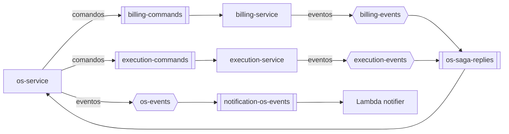

# ADR-0013: Mensageria com SNS, SQS e DLQ

- **Status:** Accepted
- **Data:** 2026-10
- **Decisão por:** Reservoir Devs

## Contexto

A saga da OS ([ADR-0017](./0017-saga-orquestrada-no-os-service.md)) troca comandos e eventos entre três serviços, e a notificação ao cliente ([ADR-0022](./0022-notificacao-por-lambda.md)) reage a cada mudança de status. O enunciado pede mensageria assíncrona e cita RabbitMQ, Kafka e SQS como exemplos.

Restrições do ambiente:

- O projeto roda no AWS Academy Learner Lab, com crédito fechado e sessões que expiram. Tudo que cobra por hora pesa; tudo que precisa de operação manual se perde quando o lab reinicia.
- O cluster tem dois ou três `t3.medium`. Um broker dentro dele disputa CPU e memória com os serviços.
- O desenvolvimento e a homologação são locais ([ADR-0021](./0021-ambiente-unico-no-eks.md)): a mensageria precisa rodar igual na máquina.

## Decisão

**SNS para eventos, SQS para consumo, uma DLQ por fila.** No LocalStack localmente, na AWS em produção, com a mesma topologia nos dois ([`messaging.tf`](https://github.com/Kc1t/postech-tc4-infra-k8s/blob/main/messaging.tf) e [`local/localstack/init-aws.sh`](https://github.com/Kc1t/postech-tc4-infra-k8s/blob/main/local/localstack/init-aws.sh)).

- **Um tópico por publicador.** Cada serviço publica os próprios eventos no próprio tópico e não sabe quem assina. Um consumidor novo é uma fila e uma assinatura a mais, sem mudar o publicador.
- **Uma fila por consumidor.** O orquestrador lê `os-saga-replies`, que assina `billing-events` e `execution-events`. A Lambda lê `notification-os-events`, que assina `os-events`.
- **Comandos vão direto para a fila do destinatário** (`billing-commands`, `execution-commands`). Comando é ponto a ponto, com um dono só; passar por tópico só esconderia isso. O os-service escolhe o destino pelo prefixo do tipo: `billing.*`, `execution.*` ou `os.*`.
- **Raw message delivery** nas assinaturas. A fila recebe o envelope JSON do serviço sem o invólucro do SNS, e os `MessageAttributes` (`message_type`, `message_id`, `saga_id`, `os_id` e os headers de trace `traceparent`, `tracestate`, `newrelic`) viram atributos da mensagem SQS. São no máximo sete, abaixo do limite de dez. O consumidor também aceita o invólucro, para não quebrar se uma assinatura for criada sem raw delivery.
- **DLQ e redrive.** Cada fila tem `<fila>-dlq`. Depois de `maxReceiveCount = 5` entregas sem sucesso, a mensagem vai para a DLQ, que guarda por 14 dias. A `redrive_allow_policy` só aceita a fila de origem, e um alarme do CloudWatch dispara com qualquer mensagem visível na DLQ, apontando para o runbook [`docs/runbooks/dlq.md`](https://github.com/Kc1t/postech-tc4-infra-k8s/blob/main/docs/runbooks/dlq.md).
- **Parâmetros das filas:** visibilidade de 30 s (180 s na fila da Lambda, seis vezes o timeout de 30 s da function, como a AWS recomenda), long polling de 20 s, retenção de 4 dias e criptografia gerenciada pelo SQS. A policy de cada fila só aceita `sqs:SendMessage` do SNS com `aws:SourceArn` igual aos tópicos que ela assina.
- **Semântica de entrega:** pelo menos uma vez, sem ordem. Quem consome é idempotente ([ADR-0018](./0018-outbox-inbox-e-lock-otimista.md)), e o orquestrador ignora respostas fora de etapa. O `DiagnosisCompleted` pode chegar antes do `DiagnosisStarted`, por exemplo.

## Alternativas consideradas

1. **RabbitMQ.** É o broker das aulas de SAGA, e exchanges e filas dariam a mesma topologia. Descartado pela operação: no cluster seria um StatefulSet com volume, disputando os `t3.medium` com os serviços e perdido a cada recriação do lab; no Amazon MQ seria um broker cobrado por hora, ligado ou ocioso. SNS e SQS não têm nada para manter de pé.

2. **Kafka (MSK ou no cluster).** Ordem por partição e reprocessamento do log seriam úteis em outro sistema. Aqui não fazem falta: a saga guarda o próprio estado e tolera desordem. O MSK cobra por broker-hora com no mínimo dois brokers, e Kafka no cluster é o caso do RabbitMQ com mais memória.

3. **EventBridge.** Roteamento por conteúdo e esquema registrado são vantagens reais. Descartado porque não substitui a fila: o consumidor continuaria precisando de SQS para ler no próprio ritmo, reter, reentregar e mandar para a DLQ. Seria um serviço a mais na frente da mesma topologia, e comando ponto a ponto não é caso de barramento de eventos.

4. **Step Functions.** Seria o orquestrador gerenciado da AWS, e não só o transporte. Descartado junto com a decisão de orquestrar no os-service ([ADR-0017](./0017-saga-orquestrada-no-os-service.md)): a lógica da saga sairia do código Go para uma definição em ASL, fora dos testes unitários e do BDD do serviço, e as esperas humanas (aprovação em até 72 h) exigiriam callback com task token.

5. **SNS FIFO + SQS FIFO.** Dariam ordem por grupo e deduplicação. Descartado: a deduplicação do FIFO vale por cinco minutos e não dispensa o inbox, a ordem não é necessária, e o FIFO limita o throughput por grupo de mensagens.

6. **Lambda assinando o SNS direto, sem fila.** Serve só à notificação. Descartado porque a fila dá lote, concorrência máxima, `ReportBatchItemFailures` e DLQ sob controle de quem consome.

## Consequências

### Positivas

- Nenhum broker para operar, dimensionar ou recriar. Custo por requisição, perto de zero no volume do projeto.
- Mensagem que falha cinco vezes não trava a fila. Ela fica na DLQ, com alarme e caminho de redrive.
- O publicador não conhece os consumidores de eventos: a notificação entrou sem mudar o os-service, que já publicava em `os-events`.
- O trace do New Relic atravessa a fila: o contexto vai nos atributos da mensagem e o consumidor o aceita antes de processar.
- Local e nuvem têm a mesma topologia: o e2e local exercita os mesmos nomes de fila e de tópico.

### Negativas

- **Sem ordem e com duplicatas.** Todo consumidor precisa de inbox, e o orquestrador precisa checar a etapa antes de aplicar uma resposta. É complexidade que um broker com ordem reduziria.
- **Limite de dez atributos por mensagem.** Sobram três para metadados novos.
- **Os tópicos SNS não são criptografados em repouso.** O Learner Lab não permite CMK, e a chave gerenciada exigiria `kms:GenerateDataKey` na policy das filas assinantes. As filas usam a criptografia gerenciada do SQS.
- **O redrive é manual.** Depois de corrigir a causa, alguém precisa mandar a DLQ de volta (`aws sqs start-message-move-task`). Uma mensagem esquecida na DLQ é uma saga parada.
- Os nomes não têm prefixo de ambiente, porque só produção roda na AWS. Um segundo ambiente na mesma conta exigiria renomear tudo.

## Referências

- Implementação: [`pkg/messaging/`](../../pkg/messaging/) (publicador e consumidor), [`internal/adapters/outbound/postgresql/messenger.go`](../../internal/adapters/outbound/postgresql/messenger.go) (roteamento por tipo)
- AWS — [Amazon SNS raw message delivery](https://docs.aws.amazon.com/sns/latest/dg/sns-large-payload-raw-message-delivery.html)
- AWS — [Using dead-letter queues in Amazon SQS](https://docs.aws.amazon.com/AWSSimpleQueueService/latest/SQSDeveloperGuide/sqs-dead-letter-queues.html)
