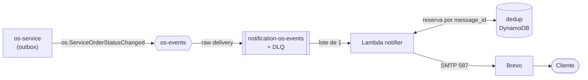

# ADR-0022: Notificação ao cliente por Lambda consumindo a fila de eventos da OS

- **Status:** Aceita
- **Data:** 2026-10
- **Decisão por:** Reservoir Devs

## Contexto

Esta ADR substitui a [ADR-0011](./0011-notificacoes-smtp-no-pod.md). Na Fase 3 o e-mail de mudança de status saía de dentro da aplicação, por SMTP síncrono, depois de gravar o novo status. A ADR-0011 registrou o desenho serverless como evolução e listou as dívidas: envio síncrono, nenhum retry e o desafio de "serverless para notificações" não atendido. A avaliação da Fase 3 apontou a notificação serverless não implementada como uma das duas lacunas da entrega.

Na Fase 4 o caminho para fechar a lacuna já existe. O os-service publica `os.ServiceOrderStatusChanged` no tópico `os-events` a cada mudança de status da OS, pelo outbox, na mesma transação do passo da saga ([ADR-0017](./0017-saga-orquestrada-no-os-service.md), [ADR-0018](./0018-outbox-inbox-e-lock-otimista.md)). O evento leva o código da OS, o status novo e o anterior, o nome, o documento e o e-mail do cliente, o total, o motivo do cancelamento e, quando aguarda pagamento, o link do checkout.

## Decisão

**Uma Lambda (`postech-tc4-prod-notifier`, repositório `postech-tc4-notification-lambda`) consome a fila `notification-os-events` e envia o e-mail.**

- **Fila própria assinando `os-events`** ([ADR-0013](./0013-mensageria-sns-sqs-dlq.md)): visibilidade de 180 s (seis vezes o timeout de 30 s da function), DLQ depois de 5 entregas, alarme do CloudWatch na DLQ. No New Relic, a falha aparece antes de chegar à DLQ, nos alertas de taxa de erro da Lambda, de falha de envio e de mensagem malformada.
- **Event source mapping** com `batch_size = 1`, concorrência máxima 5 e `ReportBatchItemFailures`: só a mensagem que falhou volta para a fila. Com lote de 1, cada invocação continua o trace distribuído da mudança de status que a originou.
- **Oito status geram e-mail:** `received`, `in_diagnosis`, `awaiting_approval`, `awaiting_payment` (com o link de pagamento), `in_execution`, `finished`, `delivered` e `cancelled` (com o motivo). O caminho feliz manda sete. O `awaiting_budget` é interno e não gera e-mail. Para o e-mail de "aguardando pagamento" sair com o link, o orquestrador só publica esse status quando chega o `PaymentLinkCreated`.
- **Idempotência por `message_id`:** antes de enviar, a Lambda grava o ID numa tabela DynamoDB (`postech-tc4-prod-notifier-dedup`) com escrita condicional. Se o ID já existe, é duplicata e não envia. Se o envio falha, apaga a reserva para a nova tentativa. O TTL (`expires_at`, 7 dias por padrão) limpa a tabela.
- **Envio pelo relay SMTP da Brevo** (`smtp-relay.brevo.com:587`), o mesmo provedor da Fase 3, com um layout HTML e o texto de cada status. O log mascara e-mail e documento.
- **Mensagem inválida** (envelope ou payload que não decodifica) volta para a fila e, depois de 5 tentativas, fica na DLQ para análise. Tipo de evento desconhecido, status sem template ou cliente sem e-mail são ignorados com sucesso.
- **Fora da VPC e com a layer do New Relic**, ligada quando a license key está configurada ([ADR-0014](./0014-lambdas-fora-da-vpc.md)). Cada envio registra o evento `NotificationSent` no New Relic.

O os-service não envia mais e-mail: o adapter SMTP e a porta `EmailNotifier` saíram do código.

## Alternativas consideradas

1. **Manter o SMTP no pod (ADR-0011).** Descartado porque deixaria a lacuna da Fase 3 aberta. Com o evento já publicado, o envio no pod seria uma segunda notificação do mesmo fato, síncrona e sem retry.

2. **Amazon SES no lugar da Brevo.** É o desenho alvo da ADR-0011 e o provedor nativo. Descartado pelo mesmo motivo de lá: a conta nova do SES começa em sandbox e só entrega para endereços verificados, o que impede demonstrar a entrega a um cliente qualquer. A Brevo já tinha conta, domínio remetente e credencial da Fase 3. Trocar de provedor é trocar o adapter `internal/mail` da Lambda, que implementa a interface `Sender` do handler.

3. **Lambda assinando o SNS direto, sem fila.** Uma peça a menos. Descartado porque, na invocação assíncrona, um erro da function é tentado de novo só duas vezes por padrão, e não há controle de lote, concorrência nem DLQ do lado de quem consome. Com a fila, um SMTP fora do ar vira mensagem esperando, não e-mail perdido.

4. **Assinatura de e-mail do próprio SNS.** Nenhum código. Descartado porque a assinatura é por tópico, não por cliente; o destinatário precisa confirmar a inscrição; e o corpo é o JSON do evento, sem template.

5. **Quarto microsserviço de notificação no EKS.** Mesma lógica, rodando como pod. Descartado porque seria um deployment com réplicas sempre ligadas para um consumo esporádico, que a Lambda cobra por invocação. E o desafio pede serverless para notificação.

## Consequências

### Positivas

- A lacuna da Fase 3 fecha: a notificação é serverless, assíncrona e com retry.
- A mudança de status não espera o SMTP. A latência e as falhas do envio ficam fora da saga.
- SMTP fora do ar não perde e-mail: a mensagem volta para a fila, tenta de novo e, no limite, fica na DLQ, com alerta no New Relic e alarme no CloudWatch. O redrive não duplica envio, por causa da tabela de dedup.
- O os-service não sabe que a notificação existe. Um canal novo (SMS, push) é outra fila assinando `os-events`.
- O e2e local verifica a notificação de ponta a ponta: sete e-mails no Mailpit no caminho feliz.

### Negativas

- **Uma queda entre a reserva e o envio perde o e-mail.** Se a Lambda estoura o timeout depois de gravar o `message_id` e antes de enviar, a reentrega encontra a reserva e trata a mensagem como duplicata. A reserva cobre o caso comum (o envio falha e a Lambda apaga a reserva), não o processo morto no meio.
- **A notificação é eventual.** Entre a mudança de status e o e-mail estão o intervalo do outbox, o SNS, a fila e a Lambda. Na prática são segundos, mas não há garantia.
- **Sem ordem entre e-mails.** Duas mudanças próximas podem chegar ao cliente fora de ordem, porque a fila padrão não ordena.
- **Credencial SMTP em variável de ambiente da Lambda**, vinda do Terraform. O Secrets Manager seria o lugar certo, ao custo de uma chamada a mais por cold start.
- **O e-mail leva o que estava no evento.** Se o cliente corrigir o e-mail depois da mudança de status, aquela notificação vai para o endereço antigo.

## Referências

- Lambda: [`postech-tc4-notification-lambda/internal/notifier/handler.go`](https://github.com/Kc1t/postech-tc4-notification-lambda/blob/main/internal/notifier/handler.go) e [`infra/main.tf`](https://github.com/Kc1t/postech-tc4-notification-lambda/blob/main/infra/main.tf)
- Evento: [`pkg/contracts/contracts.go`](../../pkg/contracts/contracts.go) (`os.ServiceOrderStatusChanged`)
- AWS: [Using Lambda with Amazon SQS](https://docs.aws.amazon.com/lambda/latest/dg/with-sqs.html)
