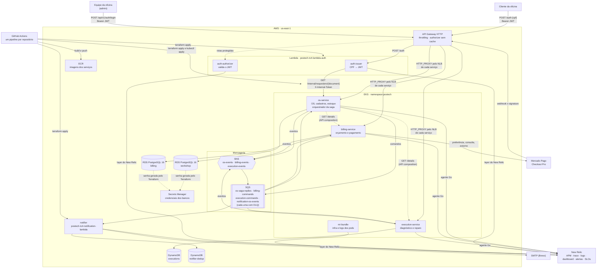

# Diagrama de componentes

Visão de nuvem da fase 4: entrada, serviços, bancos, mensageria e monitoramento. A versão da fase 3 (monolito `workshop-api`) está no [`postech-tc3-app`](https://github.com/Kc1t/postech-tc3-app/blob/main/docs/diagrams/componentes.md).

## Quem fala com quem

| Origem | Destino | Como | Por quê |
|---|---|---|---|
| Cliente, equipe, Mercado Pago | serviços | API Gateway → NLB `<serviço>-public` → pod | entrada única, authorizer na borda |
| Lambda issuer | os-service | `GET /internal/requesters/{document}` com `X-Internal-Token` | emitir o token sem abrir o banco do os-service ([ADR-0014](../adr/0014-lambdas-fora-da-vpc.md)) |
| os-service | billing, execution | REST no Service do cluster, com JWT de serviço | leitura composta do `/details` ([ADR-0019](../adr/0019-api-composition-no-details.md)) |
| os-service | billing, execution | comandos nas filas `billing-commands` e `execution-commands` | passos da saga ([ADR-0013](../adr/0013-mensageria-sns-sqs-dlq.md)) |
| billing, execution | os-service | eventos nos tópicos `billing-events` e `execution-events`, fila `os-saga-replies` | respostas da saga |
| os-service | notifier | evento `os.ServiceOrderStatusChanged` no tópico `os-events`, fila `notification-os-events` | e-mail a cada mudança de status ([ADR-0022](../adr/0022-notificacao-por-lambda.md)) |

Nenhum serviço acessa o banco de outro ([ADR-0012](../adr/0012-banco-por-servico.md)).

## Fronteiras de repositório

| Repositório | Provisiona |
|---|---|
| `postech-tc4-infra-k8s` | EKS e node group, namespace com quota, API Gateway, rotas e authorizer, tópicos, filas, DLQs e alarmes, agente do New Relic no cluster, dashboard, alertas e SLOs |
| `postech-tc4-os-service` | RDS `workshop` e o secret da credencial, imagem no ECR, manifests do serviço |
| `postech-tc4-billing-service` | RDS `billing` e o secret da credencial, imagem no ECR, manifests do serviço |
| `postech-tc4-execution-service` | tabela DynamoDB `executions`, imagem no ECR, manifests do serviço |
| `postech-tc4-lambda-auth` | Lambdas `auth-issuer` e `auth-authorizer` e os log groups |
| `postech-tc4-notification-lambda` | Lambda `notifier`, a tabela de deduplicação e o gatilho na fila `notification-os-events` |
