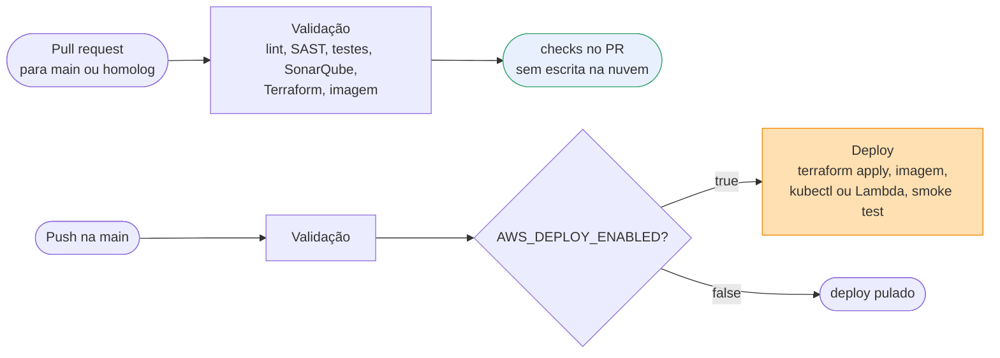
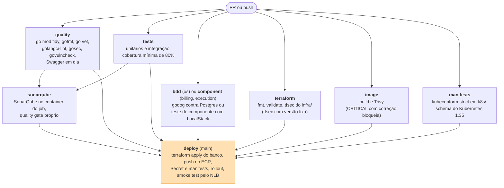
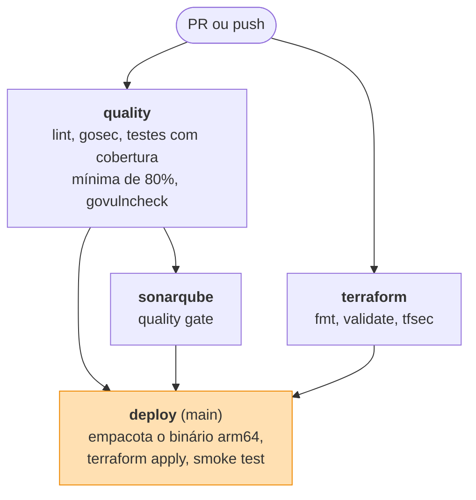
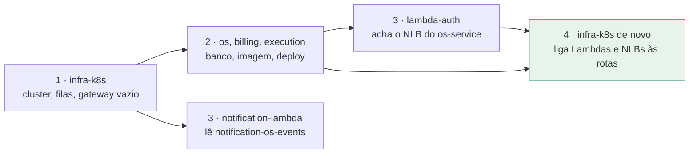

# Pipelines de CI/CD

Seis repositórios, um pipeline independente em cada. Todos rodam em pull request e push para a `main` e a `homolog`; o deploy só roda em push na `main` com a variável `AWS_DEPLOY_ENABLED=true`, porque as credenciais do Learner Lab expiram a cada sessão. A versão da fase 3 (quatro repositórios) está no [`postech-tc3-app`](https://github.com/Kc1t/postech-tc3-app/blob/main/docs/diagrams/pipelines.md).

## 1. Modelo comum

Nenhum job que roda em pull request escreve na nuvem. O deploy depende de todos os jobs de validação do mesmo pipeline.

## 2. Serviços: os, billing e execution

| Serviço | Teste extra | Banco aplicado no deploy |
|---|---|---|
| os-service | BDD da saga (godog) | RDS PostgreSQL `workshop` |
| billing-service | componente com Postgres e LocalStack | RDS PostgreSQL `billing` |
| execution-service | componente com LocalStack (DynamoDB, SQS, SNS) | tabela DynamoDB `executions` |

O job de testes publica "Cobertura do `<serviço>`: X%" no resumo, e o do SonarQube publica a tabela com o status do gate, cobertura, bugs, vulnerabilidades, code smells, hotspots e duplicação.

## 3. Lambdas: lambda-auth e notification-lambda

O deploy do lambda-auth publica os ARNs das funções no resumo; o da notification-lambda liga o gatilho na fila `notification-os-events`.

## 4. Infraestrutura: postech-tc4-infra-k8s

| Workflow | Validação | Aplicação (main) |
|---|---|---|
| `terraform.yml` | `Validate`: fmt, validate e tfsec; `Plan` em PR quando o deploy está ligado | `Apply`: cluster, filas, gateway; depois namespace, quota e LimitRange, agente do New Relic e o resumo com o endpoint do gateway |
| `observability.yml` | validate do `observability/` (só quando a pasta muda) | dashboard, alertas e SLOs no New Relic |

## 5. Ordem do primeiro deploy

O gateway acha as Lambdas pelo nome e os NLBs pela tag do Service, então nenhum valor é copiado à mão entre repositórios: o segundo `apply` do infra-k8s só cria as rotas do que já existe.

## 6. Secrets e variáveis por repositório

Configurados por `scripts/setup-github.sh` no infra-k8s, sem o valor passar pela linha de comando.

| Nome | Tipo | os | billing | execution | lambda-auth | notification | infra-k8s |
|---|---|---|---|---|---|---|---|
| `AWS_ACCESS_KEY_ID`, `AWS_SECRET_ACCESS_KEY`, `AWS_SESSION_TOKEN` | secret | x | x | x | x | x | x |
| `TF_STATE_BUCKET` | secret | x | x | x | x | x | x |
| `NEW_RELIC_LICENSE_KEY` | secret | x | x | x | x | x | x |
| `JWT_SECRET` | secret | x | x | x | x | | |
| `INTERNAL_API_TOKEN` | secret | x | | | x | | |
| `ADMIN_PASSWORD` | secret | x | | | | | |
| `MP_ACCESS_TOKEN`, `MP_WEBHOOK_SECRET` | secret | | x | | | | |
| `SMTP_USERNAME`, `SMTP_PASSWORD` | secret | | | | | x | |
| `NEW_RELIC_API_KEY` | secret | | | | | | x |
| `AWS_REGION`, `AWS_DEPLOY_ENABLED` | variável | x | x | x | x | x | x |
| `CORS_ALLOWED_ORIGINS`, `FAULT_INJECTION_ENABLED`, `EKS_CLUSTER_NAME` | variável | x | x | x | | | |
| `PAYMENT_GATEWAY` | variável | | x | | | | |
| `SMTP_FROM` | variável | | | | | x | |
| `NEW_RELIC_ACCOUNT_ID` | variável | | | | x | x | x |
| `NEW_RELIC_ALERT_EMAIL` | variável | | | | | | x |

O `JWT_SECRET` é o mesmo nos três serviços e no lambda-auth, e o `INTERNAL_API_TOKEN` é o mesmo no os-service e no lambda-auth.

## 7. Proteção da `main`

Nos seis repositórios: merge só por pull request, checks obrigatórios, branch atualizada com a `main` antes do merge e conversas resolvidas, valendo também para administradores.

| Repositório | Checks obrigatórios |
|---|---|
| os-service | Lint, SAST e dependências; Testes e cobertura; BDD da saga (godog); SonarQube (quality gate); Terraform do banco; Imagem (build e Trivy) |
| billing-service | os mesmos, com Teste de componente (Postgres + LocalStack) no lugar do BDD |
| execution-service | os mesmos, com Teste de componente (LocalStack) no lugar do BDD |
| lambda-auth, notification-lambda | Lint, SAST e testes; SonarQube (quality gate); Terraform (fmt, validate, tfsec) |
| infra-k8s | Validate |
