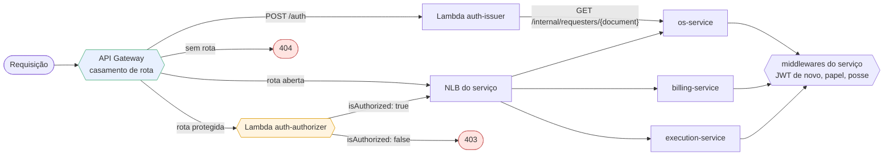
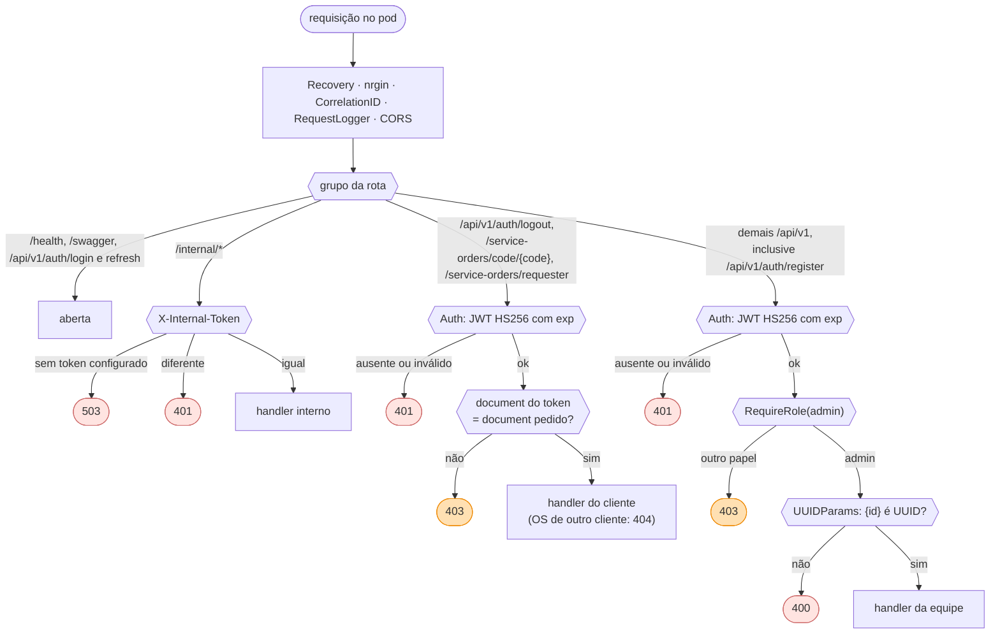
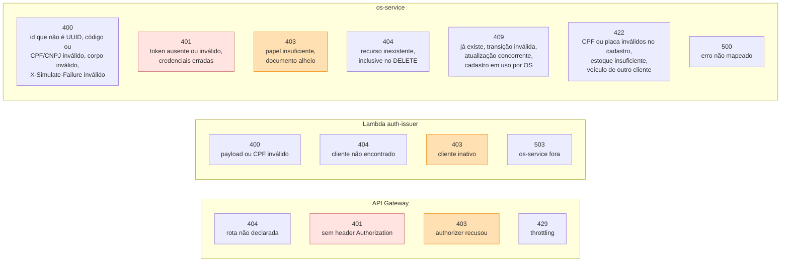

# Roteamento

Toda requisição externa passa por duas decisões: o **API Gateway** escolhe o serviço e decide se chama o authorizer; depois o **roteador do serviço** escolhe o grupo de middlewares. Este documento desenha as duas para a fase 4, com o os-service como exemplo do lado do serviço. A versão da fase 3 (um backend só) está no [`postech-tc3-app`](https://github.com/Kc1t/postech-tc3-app/blob/main/docs/diagrams/roteamento.md).

## 1. O caminho de uma requisição

Passar pelo authorizer não dispensa os middlewares do serviço. São duas decisões independentes sobre o mesmo token, e a segunda ainda confere papel e posse. O NLB de cada serviço é público, então essa segunda validação também cobre quem chama o NLB direto ([ADR-0007](../adr/0007-api-gateway-comunicacao.md)).

## 2. Rotas do API Gateway

Declaradas em [`postech-tc4-infra-k8s/api_gateway.tf`](https://github.com/Kc1t/postech-tc4-infra-k8s/blob/main/api_gateway.tf). A integração com os serviços é `HTTP_PROXY` para o NLB do Service `<serviço>-public`, com o caminho original repassado inteiro e timeout de 10 s.

| Rota | Destino | Authorizer |
|---|---|---|
| `POST /auth` | Lambda auth-issuer | não (limite próprio: 10 req/s, rajada de 20) |
| `GET /health` | os-service | não |
| `POST /api/v1/auth/{proxy+}` | os-service (login, refresh, logout e register da equipe) | não; o logout e o register exigem JWT no serviço, e o register, papel `admin` |
| `ANY /api/v1/service-orders` e `/{proxy+}` | os-service | sim |
| `ANY /api/v1/requesters`, `/vehicles`, `/services`, `/parts` e `/{proxy+}` de cada um | os-service | sim |
| `ANY /api/v1/budgets/{proxy+}` | billing-service | sim |
| `ANY /api/v1/payments/{proxy+}` | billing-service | sim |
| `POST /api/v1/webhooks/mercadopago` | billing-service | não (a autenticidade vem da assinatura `x-signature`) |
| `GET /fake-checkout/{proxy+}` | billing-service | não (página do gateway fake de pagamento) |
| `ANY /api/v1/executions/{proxy+}` | execution-service | sim |

- O stage `$default` limita a 100 req/s com rajada de 200 e grava access log no CloudWatch.
- O authorizer é do tipo `REQUEST`, com resposta simples e cache desligado. Sem o header `Authorization` o gateway responde 401 sem chamar a Lambda; com token recusado, 403.
- Uma rota protegida só é criada quando o authorizer existe, e as rotas de um serviço só são criadas quando o NLB dele existe. O Terraform acha as Lambdas pelo nome e os NLBs pela tag `kubernetes.io/service-name`, sem valores copiados à mão entre repositórios.
- `/internal/*` não tem rota no gateway.

## 3. Roteamento no os-service

O `UUIDParams` roda nos grupos `service-orders`, `requesters`, `vehicles`, `services` e `parts`, depois da autenticação e do papel. Na consulta do cliente por código, o handler recusa código não numérico ou ≤ 0 e CPF/CNPJ inválido com 400 antes de conferir a posse. O `logout` usa o mesmo grupo autenticado das rotas do cliente, sem a checagem de posse. As rotas estão em [`cmd/api/routes/routes.go`](../../cmd/api/routes/routes.go) e em cada `handler.go` de `internal/adapters/inbound/http`.

### Inventário do os-service

| Grupo | Rotas | Acesso |
|---|---|---|
| Saúde e documentação | `GET /health`, `/health/live`, `/health/ready`, `/swagger/*` | aberta |
| Autenticação da equipe | `POST /api/v1/auth/login` e `/refresh`; `POST /api/v1/auth/logout`; `POST /api/v1/auth/register` | login e refresh abertas; logout com qualquer JWT; register só `admin` ([ADR-0023](../adr/0023-registro-restrito-a-equipe.md)) |
| Interna | `GET /internal/requesters/{document}` | `X-Internal-Token` |
| Cliente | `GET /api/v1/service-orders/code/{code}?document=`, `GET /api/v1/service-orders/requester?document=` | JWT com o `document` pedido |
| Solicitantes | `POST`, `GET` em `/api/v1/requesters`; `GET /document/{document}`; `GET`, `PUT`, `DELETE /{id}`; `GET /{id}/vehicles` | `admin` |
| Veículos, serviços | `POST`, `GET` na coleção; `GET`, `PUT`, `DELETE /{id}` | `admin` |
| Peças | as mesmas e `PATCH /api/v1/parts/{id}/stock` | `admin` |
| Ordens de serviço | `POST`, `GET /api/v1/service-orders`; `GET /{id}`, `/{id}/details`, `/{id}/history`; `POST /{id}/cancel`, `/{id}/deliver`; `GET /metrics/execution-time` | `admin` |

Contratos completos no [Swagger](../swagger.yaml). Papéis e posse dos outros serviços em [`../SEGURANCA.md`](../SEGURANCA.md).

## 4. Onde nasce cada código de resposta

O mesmo código pode vir de camadas diferentes, e isso importa ao depurar. Um 401 ou 403 do gateway não aparece nos logs do serviço, porque a requisição nunca chega ao pod: a evidência está no access log do gateway (campo `authorizer`) e nos logs da Lambda authorizer. O corpo de erro dos serviços é sempre `{"error": {"code", "message"}}`; a tabela erro → status está em [`internal/adapters/inbound/http/errors.go`](../../internal/adapters/inbound/http/errors.go) e na [ADR-0006](../adr/0006-domain-errors-sentinels.md).
