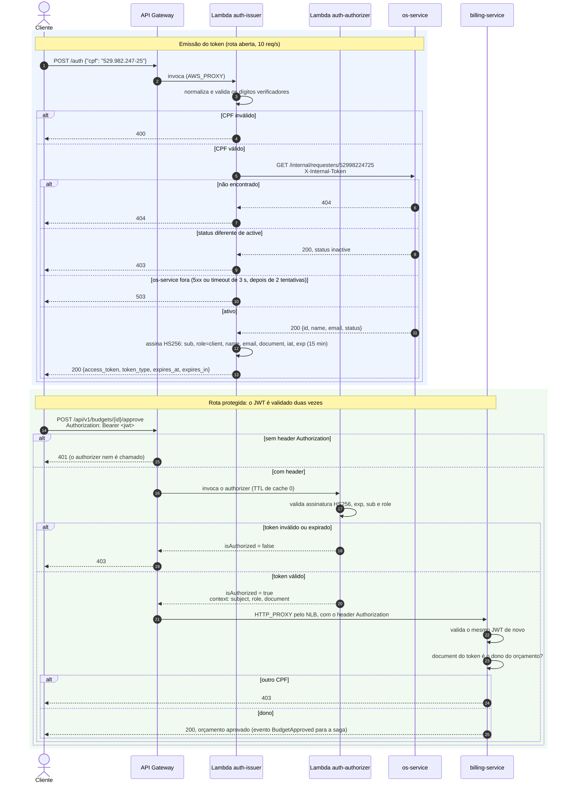

# Diagrama de sequência: autenticação por CPF

O cliente troca o CPF por um JWT e usa o token numa rota protegida. Na fase 4 a Lambda issuer não abre mais o banco: consulta o os-service pela rota interna ([ADR-0014](../adr/0014-lambdas-fora-da-vpc.md)). A versão da fase 3 está no [`postech-tc3-app`](https://github.com/Kc1t/postech-tc3-app/blob/main/docs/diagrams/sequencia-autenticacao.md).

## Pontos de decisão

| Ponto | Regra |
|---|---|
| Validação do CPF | dígitos verificadores calculados na Lambda, antes de qualquer chamada ao os-service |
| Consulta do cliente | `GET /internal/requesters/{document}` no os-service, com `X-Internal-Token`; a rota não existe no gateway |
| Status | só `active` recebe token; qualquer outro valor resulta em 403 |
| Falha do os-service | timeout de 3 s por tentativa, uma nova tentativa em erro de rede ou 5xx, e então 503 |
| Cache do authorizer | zero: desativar um cliente vale na requisição seguinte |
| Segunda validação | cada serviço repete a verificação do JWT, o que cobre o acesso direto ao NLB |
| Posse | o os-service e o billing conferem se o `document` do token é o dono do recurso (403 se não for) |

A resposta separa "não existe" (404) de "existe mas está inativo" (403). Isso ajuda o cliente legítimo e permite enumerar CPFs cadastrados; a mitigação é o limite próprio de `POST /auth` no gateway (10 req/s, rajada de 20), registrada como risco aceito na [RFC-0003](../rfc/0003-autenticacao-por-cpf.md). Controles e testes de cada camada em [`../SEGURANCA.md`](../SEGURANCA.md).
