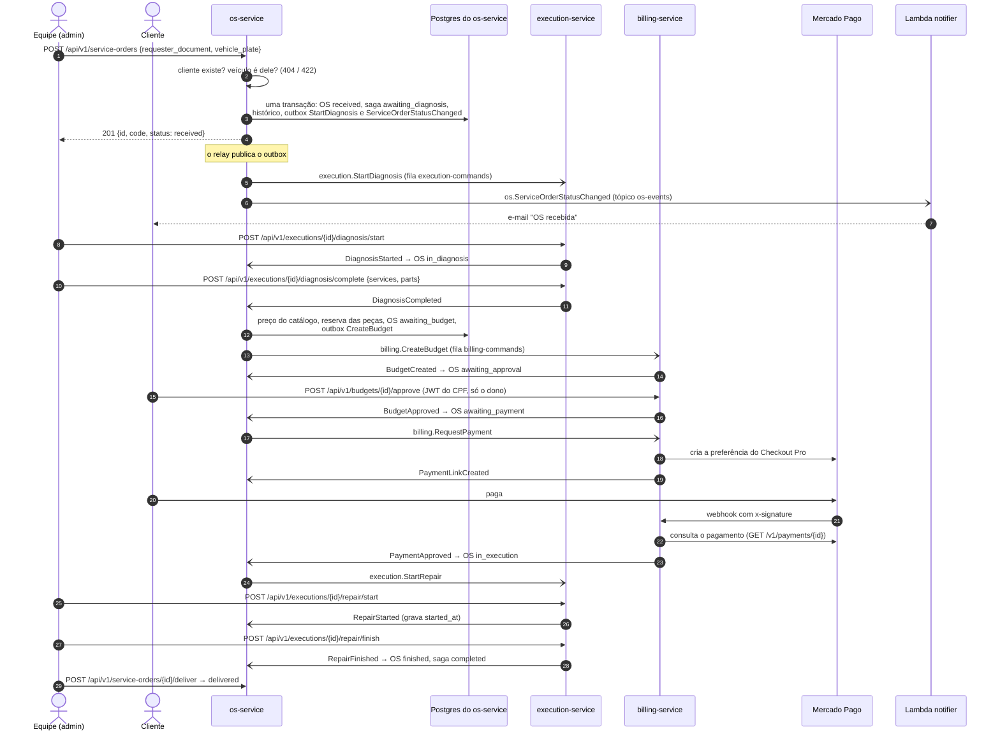
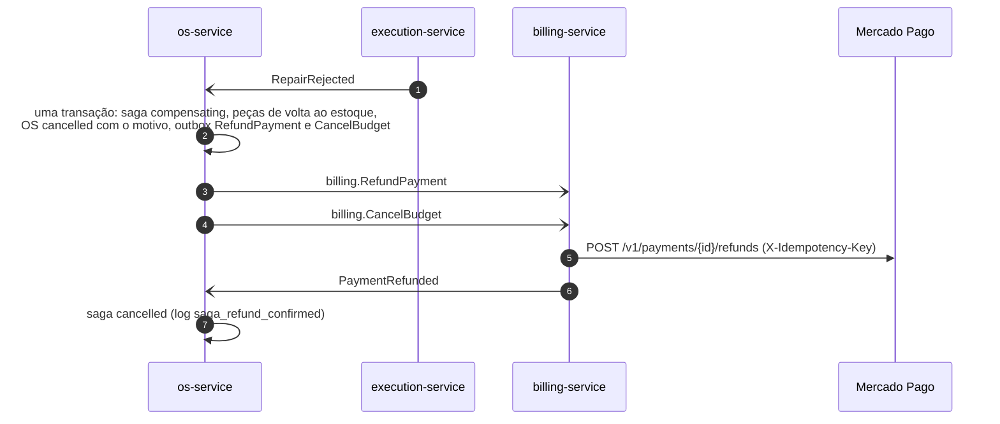
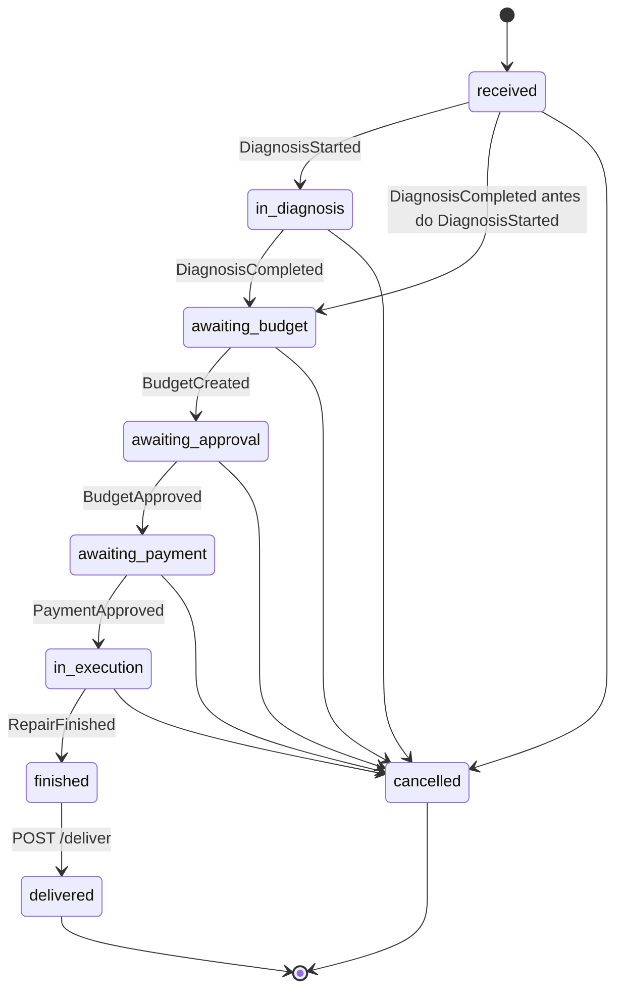
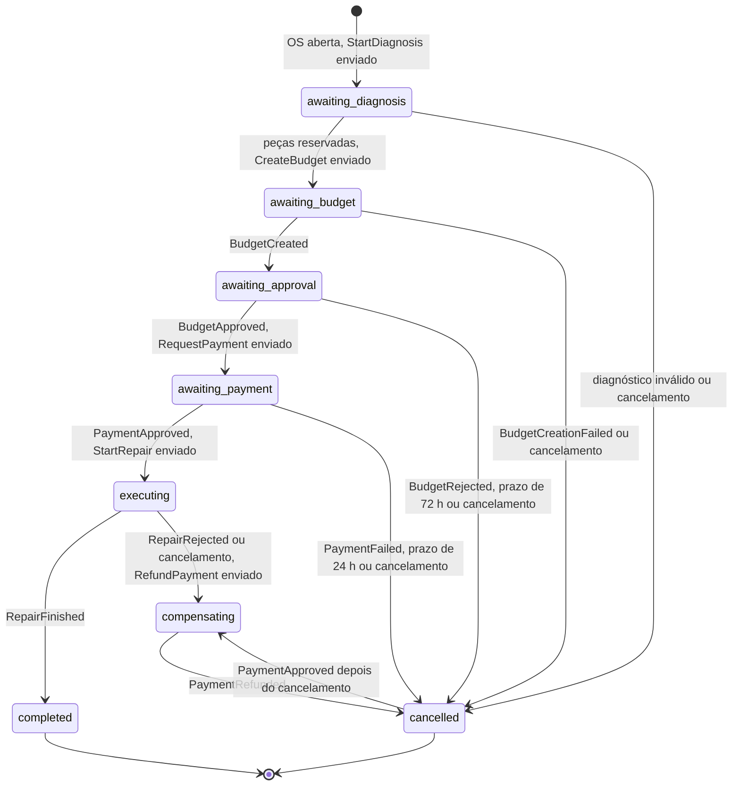

# Diagrama de sequência: ordem de serviço e saga

Da abertura da OS até a entrega, com as mensagens da saga entre os serviços. A versão da fase 3 (monolito, status alterado por `PUT`) está no [`postech-tc3-app`](https://github.com/Kc1t/postech-tc3-app/blob/main/docs/diagrams/sequencia-ordem-servico.md).

## Caminho feliz

Cada mudança de status da OS grava uma linha em `service_order_status_history` e publica `os.ServiceOrderStatusChanged`, que vira um e-mail para o cliente. A exceção é `awaiting_payment`: o evento sai no `PaymentLinkCreated`, já com o link de pagamento. Cada passo é uma transação local com o outbox; o consumidor registra o `message_id` no inbox na mesma transação.

## Compensação: reparo recusado depois do pagamento

A execução não recebe `CancelExecution` aqui, porque foi ela que recusou. Sem pagamento aprovado não há estorno, e a saga vai direto para `cancelled`. As outras compensações seguem o mesmo padrão, conforme a etapa em que a saga estava: tabela em [Compensações](../../README.md#compensações) no README.

## Máquina de estados da OS

As transições ficam em `validTransitions` (`internal/domain/entities/service_order.go`). Fora delas, o domínio devolve `ErrInvalidStatus` (409). `received → awaiting_budget` existe porque o SNS/SQS não garante ordem: o `DiagnosisCompleted` pode chegar antes do `DiagnosisStarted`.

## Máquina de estados da saga

Os estados ficam em `internal/domain/entities/saga.go`. Resposta que não corresponde ao estado atual é registrada no inbox e ignorada (`ErrSagaOutOfStep`).

## Origem dos números do dashboard

| Painel | Fonte |
|---|---|
| Funil da saga e passos por estado | logs `saga_started`, `saga_step` (com `saga_state` e `os_status`) e `saga_completed` |
| Concluídas, compensadas e expiradas | logs `saga_completed`, `saga_compensated` (com `reason`) e `saga_expired` |
| Estornos confirmados | log `saga_refund_confirmed` |
| Latência e erros por serviço | transações do APM (`nrgin`) |
| Mensageria | transações `OutboxRelay/<tipo>` e `Consume/<tipo>`, logs `message_failed` e `outbox_message_stuck` |

Os logs são JSON com o texto em `message` e `trace.id`, `saga_id`, `os_id` e `correlation_id`, enviados pelo agente do New Relic. Dashboard e alertas em Terraform no [`postech-tc4-infra-k8s/observability`](https://github.com/Kc1t/postech-tc4-infra-k8s/tree/main/observability).
